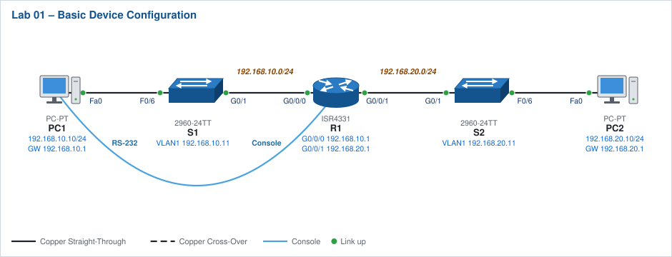

# Lab 01 – Packet Tracer Introduction & Basic Device Configuration

**Session 1 · Periods 1–5 · 225 minutes**

## Objectives

After completing this lab you will be able to:

- Navigate the Packet Tracer interface, place devices and choose the correct cables.
- Move between Cisco IOS CLI modes and use the context-sensitive help.
- Perform a basic, secure configuration of a Cisco switch and router.
- Configure IPv4 addressing on router interfaces, a switch SVI and PCs.
- Configure and test SSH remote management.
- Save, verify and back up device configurations.

## Required Resources

| Qty | Device | Model |
|-----|--------|-------|
| 1 | Router | ISR4331 |
| 2 | Switch | 2960-24TT |
| 2 | PC | PC-PT |
| – | Cables | Console, Copper Straight-Through |

## Topology



<details>
<summary>Text version of the topology</summary>

```
                         G0/0/0           G0/0/1
          192.168.10.0/24 +-------------+ 192.168.20.0/24
   PC1 ------- S1 --------|     R1      |-------- S2 ------- PC2
      Fa0   F0/6   G0/1   +-------------+   G0/1   F0/6   Fa0
```

</details>

## Addressing Table

| Device | Interface | IPv4 Address | Subnet Mask | Default Gateway |
|--------|-----------|--------------|-------------|-----------------|
| R1 | G0/0/0 | 192.168.10.1 | 255.255.255.0 | N/A |
| R1 | G0/0/1 | 192.168.20.1 | 255.255.255.0 | N/A |
| S1 | VLAN 1 | 192.168.10.11 | 255.255.255.0 | 192.168.10.1 |
| S2 | VLAN 1 | 192.168.20.11 | 255.255.255.0 | 192.168.20.1 |
| PC1 | NIC | 192.168.10.10 | 255.255.255.0 | 192.168.10.1 |
| PC2 | NIC | 192.168.20.10 | 255.255.255.0 | 192.168.20.1 |

---

## Period 1 – Part 1: Explore Packet Tracer and Build the Topology

> 💡 Read [docs/packet-tracer-quickstart.md](../../docs/packet-tracer-quickstart.md) sections 2–4 first (5 minutes).

### Step 1: Start a new file

1. Open Packet Tracer → **File → New**.
2. Immediately **File → Save As** → `lab01-<your-name>.pkt`.
3. **Options → Preferences → Interface** tab: tick **Always Show Port Labels in Logical Workspace**.

### Step 2: Place the devices

1. Click **Network Devices → Routers** and drag one **4331** onto the workspace.
2. Click **Network Devices → Switches** and drag two **2960** switches onto the workspace.
3. Click **End Devices → End Devices** and drag two **PC** icons onto the workspace.
4. Rename the display labels: *R1*, *S1*, *S2*, *PC1*, *PC2* (click the label under the icon and type).
5. Arrange them as in the topology diagram.

### Step 3: Examine the router hardware

1. Click **R1** → **Physical** tab.
2. Zoom in and locate: power switch, `GE 0/0/0`, `GE 0/0/1`, `GE 0/0/2`, Console port, NIM slots.
3. Click the **Config** tab and notice the *equivalent IOS commands* panel at the bottom – every GUI change produces a CLI command.

   > ⚠️ In this course we configure **only through the CLI**. The Config tab is just for exploration.

### Step 4: Cable the network

Click **Connections** (lightning bolt) and select **Copper Straight-Through** (solid black line).

| From | Port | To | Port |
|------|------|----|------|
| PC1 | FastEthernet0 | S1 | FastEthernet0/6 |
| S1 | GigabitEthernet0/1 | R1 | GigabitEthernet0/0/0 |
| R1 | GigabitEthernet0/0/1 | S2 | GigabitEthernet0/1 |
| S2 | FastEthernet0/6 | PC2 | FastEthernet0 |

Then connect a **Console** cable (light blue) from **PC1 RS 232** to **R1 Console**.

### Step 5: Observe link lights

- PC ↔ switch links turn **amber → green** after ~30 seconds (STP). Click **Fast Forward Time** to speed this up.
- Router ↔ switch links stay **red** on the router side. Why? *(Answer: router interfaces are administratively down by default.)*

### Step 6: Access R1 through the console

1. Click **PC1 → Desktop → Terminal** → keep the default settings (9600, 8, None, 1, None) → **OK**.
2. Press Enter. If you see the *System Configuration Dialog*, answer `no`:

   ```
   Would you like to enter the initial configuration dialog? [yes/no]: no
   Press RETURN to get started!
   Router>
   ```

3. Close the terminal window. From now on you can also use the **CLI** tab of each device.

✅ **Checkpoint 1:** All 5 devices placed and labeled, 4 Ethernet links + 1 console cable connected, file saved.

---

## Period 2 – Part 2: Navigate the Cisco IOS CLI

Use **S1 → CLI** for this part.

### Step 1: User EXEC and Privileged EXEC modes

```
Switch>                          ! User EXEC – limited monitoring
Switch> enable
Switch#                          ! Privileged EXEC – all show/debug/copy commands
Switch# disable
Switch>
```

### Step 2: Context-sensitive help

```
Switch> ?                        ! list all commands available in this mode
Switch> en?                      ! commands that start with "en"
Switch> enable
Switch# show ?                   ! list everything you can show
Switch# clock ?
Switch# clock set ?
Switch# clock set 09:00:00 14 Nov 2026
Switch# show clock
```

> 💡 `?` directly after letters (no space) completes a **word**; `?` after a space lists the **next keyword**.

### Step 3: Command abbreviation and Tab completion

```
Switch# sh ver                   ! = show version
Switch# conf<Tab>                ! completes to "configure"
Switch# sh ip int br             ! = show ip interface brief
```

### Step 4: Read common error messages

Type each line and note the error:

| Typed | Error message | Meaning |
|-------|---------------|---------|
| `cl` | `% Ambiguous command: "cl"` | Not enough letters (clear? clock?) |
| `clock` | `% Incomplete command.` | More keywords required |
| `clock set aa:12:23` | `% Invalid input detected at '^' marker.` | Wrong syntax at the `^` position |
| `hello` | `Translating "hello"...domain server` | IOS thinks it's a hostname to Telnet to – press **Ctrl+Shift+6** |

### Step 5: Explore show commands

```
Switch# show version
Switch# show running-config
Switch# show startup-config      ! "startup-config is not present" – nothing saved yet
Switch# show interfaces f0/6
Switch# show ip interface brief
Switch# show mac address-table
Switch# show history
```

Record in your report:

1. The IOS version and image file name (`show version`).
2. The MAC address of `F0/6` (`show interfaces f0/6`, field *address is*).
3. How many FastEthernet and GigabitEthernet ports S1 has.

### Step 6: Global and interface configuration modes

```
Switch# configure terminal
Switch(config)# interface f0/6
Switch(config-if)# exit
Switch(config)# line console 0
Switch(config-line)# end         ! (or Ctrl+Z) jumps straight back to privileged EXEC
Switch#
```

✅ **Checkpoint 2:** You can explain the four prompts `>`, `#`, `(config)#`, `(config-if)#` and use `?` to find any command.

---

## Period 3 – Part 3: Basic Switch Configuration

Configure **S1** first, then repeat for **S2** using the S2 values from the addressing table.

### Step 1: Hostname and disable DNS lookup

```
Switch> enable
Switch# configure terminal
Switch(config)# hostname S1
S1(config)# no ip domain-lookup
```

### Step 2: Secure privileged EXEC and the console

```
S1(config)# enable secret class
S1(config)# line console 0
S1(config-line)# password cisco
S1(config-line)# login
S1(config-line)# logging synchronous      ! stops log messages from breaking your typing
S1(config-line)# exec-timeout 10 0        ! log out after 10 minutes idle
S1(config-line)# exit
```

### Step 3: Secure the VTY lines (temporary – replaced by SSH in Part 5)

```
S1(config)# line vty 0 15
S1(config-line)# password cisco
S1(config-line)# login
S1(config-line)# exit
```

### Step 4: Encrypt plaintext passwords and add a banner

```
S1(config)# service password-encryption
S1(config)# banner motd #Unauthorized access is strictly prohibited!#
```

Verify:

```
S1(config)# do show running-config | include password
 password 7 0822455D0A16          ! type 7 = weak, reversible encryption
S1(config)# do show running-config | include secret
enable secret 5 $1$mERr$...        ! type 5 = MD5 hash
```

> 💡 `enable secret` is always hashed. `enable password` is stored in plaintext and should never be used.

### Step 5: Configure the management SVI and default gateway

A Layer 2 switch has no routed ports; it is managed through a **Switch Virtual Interface (SVI)**.

```
S1(config)# interface vlan 1
S1(config-if)# description Management SVI
S1(config-if)# ip address 192.168.10.11 255.255.255.0
S1(config-if)# no shutdown
S1(config-if)# exit
S1(config)# ip default-gateway 192.168.10.1
```

> ⚠️ Without `ip default-gateway`, the switch can be managed only from its own subnet.

### Step 6: Describe ports and shut down unused ports

```
S1(config)# interface f0/6
S1(config-if)# description Link to PC1
S1(config-if)# exit
S1(config)# interface g0/1
S1(config-if)# description Link to R1 G0/0/0
S1(config-if)# exit
S1(config)# interface range f0/1 - 5 , f0/7 - 24 , g0/2
S1(config-if-range)# shutdown
S1(config-if-range)# end
```

### Step 7: Save the configuration

```
S1# copy running-config startup-config
Destination filename [startup-config]? <Enter>
[OK]
```

> 💡 Packet Tracer also needs the `.pkt` file saved (**Ctrl+S**). `copy run start` saves to the device's NVRAM *inside* the `.pkt`.

### Step 8: Test the console security

```
S1# exit
<Enter>
Unauthorized access is strictly prohibited!
User Access Verification
Password: cisco
S1> enable
Password: class
S1#
```

### Step 9: Repeat for S2

Use hostname `S2`, SVI `192.168.20.11/24`, default gateway `192.168.20.1`, and the correct descriptions.

✅ **Checkpoint 3:**

```
S1# show ip interface brief
Interface              IP-Address      OK? Method Status                Protocol
...
Vlan1                  192.168.10.11   YES manual up                    up
```

> ⚠️ `Vlan1` may show `up/down` until a port in VLAN 1 is up. As long as F0/6 or G0/1 is connected, it should be `up/up`.

---

## Period 4 – Part 4: Basic Router Configuration and End-to-End Connectivity

### Step 1: Basic settings on R1

```
Router> enable
Router# configure terminal
Router(config)# hostname R1
R1(config)# no ip domain-lookup
R1(config)# enable secret class
R1(config)# line console 0
R1(config-line)# password cisco
R1(config-line)# login
R1(config-line)# logging synchronous
R1(config-line)# exit
R1(config)# line vty 0 4
R1(config-line)# password cisco
R1(config-line)# login
R1(config-line)# exit
R1(config)# service password-encryption
R1(config)# banner motd #Unauthorized access is strictly prohibited!#
```

### Step 2: Configure the router interfaces

```
R1(config)# interface g0/0/0
R1(config-if)# description LAN 192.168.10.0/24 - S1
R1(config-if)# ip address 192.168.10.1 255.255.255.0
R1(config-if)# no shutdown
%LINK-5-CHANGED: Interface GigabitEthernet0/0/0, changed state to up
R1(config-if)# exit
R1(config)# interface g0/0/1
R1(config-if)# description LAN 192.168.20.0/24 - S2
R1(config-if)# ip address 192.168.20.1 255.255.255.0
R1(config-if)# no shutdown
R1(config-if)# end
R1# copy running-config startup-config
```

The red link lights on R1 turn green.

### Step 3: Configure the PCs

On **PC1 → Desktop → IP Configuration → Static**:

| Field | PC1 | PC2 |
|-------|-----|-----|
| IPv4 Address | 192.168.10.10 | 192.168.20.10 |
| Subnet Mask | 255.255.255.0 | 255.255.255.0 |
| Default Gateway | 192.168.10.1 | 192.168.20.1 |

Verify on **PC1 → Desktop → Command Prompt**:

```
C:\> ipconfig
```

### Step 4: Verify the router

```
R1# show ip interface brief
Interface              IP-Address      OK? Method Status                Protocol
GigabitEthernet0/0/0   192.168.10.1    YES manual up                    up
GigabitEthernet0/0/1   192.168.20.1    YES manual up                    up
GigabitEthernet0/0/2   unassigned      YES unset  administratively down down
Vlan1                  unassigned      YES unset  administratively down down

R1# show ip route
...
C    192.168.10.0/24 is directly connected, GigabitEthernet0/0/0
L    192.168.10.1/32 is directly connected, GigabitEthernet0/0/0
C    192.168.20.0/24 is directly connected, GigabitEthernet0/0/1
L    192.168.20.1/32 is directly connected, GigabitEthernet0/0/1

R1# show interfaces description
```

> 💡 **C** = connected network, **L** = local host route (the router's own address).

### Step 5: Test connectivity

From **PC1 Command Prompt**:

| Test | Command | Expected |
|------|---------|----------|
| Own gateway | `ping 192.168.10.1` | Success |
| S1 SVI | `ping 192.168.10.11` | Success |
| Remote gateway | `ping 192.168.20.1` | Success |
| PC2 | `ping 192.168.20.10` | Success (first packet may time out – ARP) |
| S2 SVI | `ping 192.168.20.11` | Success |
| Path | `tracert 192.168.20.10` | 2 hops: 192.168.10.1 → 192.168.20.10 |

### Step 6: Watch the ping in Simulation mode

1. Click **Simulation** → **Edit Filters** → select only **ICMP** and **ARP**.
2. Run `ping 192.168.20.10` from PC1 again (or use **Add Simple PDU** PC1 → PC2).
3. Click **Capture/Forward** repeatedly. Click on an envelope to open the **OSI Model** and **Inbound/Outbound PDU Details** tabs.
4. Answer: at R1, which Layer 2 fields are changed? Which Layer 3 fields stay the same?
5. Return to **Realtime** mode.

✅ **Checkpoint 4:** PC1 can ping PC2 and both switch SVIs.

---

## Period 5 – Part 5: Configure SSH and Manage Configurations

Telnet sends passwords in clear text. Replace it with **SSH version 2** on R1, S1 and S2.

### Step 1: Configure SSH on R1

```
R1(config)# ip domain-name ccna-lab.com
R1(config)# username admin secret Cisco123!
R1(config)# crypto key generate rsa general-keys modulus 1024
The name for the keys will be: R1.ccna-lab.com
% The key modulus size is 1024 bits
% Generating 1024 bit RSA keys, keys will be non-exportable...[OK]
*Mar 1 0:12:3.456: %SSH-5-ENABLED: SSH 1.99 has been enabled
R1(config)# ip ssh version 2
R1(config)# ip ssh time-out 60
R1(config)# ip ssh authentication-retries 3
R1(config)# line vty 0 4
R1(config-line)# transport input ssh
R1(config-line)# login local
R1(config-line)# exec-timeout 5 0
R1(config-line)# end
```

> ⚠️ A hostname other than `Router` and an `ip domain-name` are required **before** generating RSA keys. SSH v2 needs a modulus of **at least 768 bits**.

### Step 2: Configure SSH on S1 and S2

Repeat Step 1 on both switches, using `line vty 0 15`.

### Step 3: Verify SSH

```
R1# show ip ssh
SSH Enabled - version 2.0
Authentication timeout: 60 secs; Authentication retries: 3

R1# show ssh            ! shows active sessions (run after the next step)
```

### Step 4: Connect from PC1

```
C:\> telnet 192.168.10.1
Trying 192.168.10.1 ...Open
[Connection to 192.168.10.1 closed by foreign host]     ! Telnet refused – good!

C:\> ssh -l admin 192.168.10.1
Password: Cisco123!
Unauthorized access is strictly prohibited!
R1> enable
Password: class
R1# exit

C:\> ssh -l admin 192.168.20.11     ! S2 across the router
```

### Step 5: Additional security hardening (R1)

```
R1(config)# security passwords min-length 8
R1(config)# login block-for 120 attempts 3 within 60
R1(config)# end
```

> 💡 `login block-for` blocks all login attempts for 120 s if 3 attempts fail within 60 s – protection against brute-force attacks.

### Step 6: Save and compare configurations

```
R1# copy running-config startup-config
R1# show startup-config
R1# reload                  ! confirm – the router restarts with startup-config
```

After reload, verify that hostname, IP addresses and SSH still work.

### Step 7: Back up configuration as text

1. `R1# show running-config` → select all output → copy into a text file `R1-config.txt`.
2. Repeat for S1 and S2. Attach these files to your lab report.

> 💡 In a real network you would use `copy running-config tftp:` to a TFTP server. Packet Tracer supports this too – optional extension: add a **Server**, enable **Services → TFTP**, and run `copy running-config tftp` from R1.

### Challenge (Extra credit)

1. Configure the router so that a user who is idle for **3 minutes** on the console is logged out.
2. Make S2's management interface reachable **only** via SSH from PC1's subnet (hint: preview of Lab 6 – `access-class` on the VTY lines with a standard ACL).
3. Find the command that shows how long R1 has been running and when the configuration was last changed.

✅ **Checkpoint 5:** PC1 can SSH to R1, S1 and S2; Telnet is refused; configurations survive a reload.

---

## Troubleshooting

| Symptom | Check |
|---------|-------|
| Router interface red | `no shutdown`, correct cable, correct port |
| PC1 can't ping its gateway | PC IP/mask/gateway, router interface IP, `show ip int brief` |
| PC1 pings gateway but not PC2 | PC2 default gateway; R1 G0/0/1 status |
| Switch SVI unreachable | `interface vlan 1` `no shutdown`; `ip default-gateway` |
| `% Please define a domain-name first.` | `ip domain-name` before `crypto key generate rsa` |
| `% Login disabled on line ...` | VTY has `login local` but no `username` exists |

## Review Questions

1. What is the difference between `enable password` and `enable secret`?
2. Why does a Layer 2 switch need `ip default-gateway`?
3. What is the difference between `running-config` and `startup-config`, and where are they stored?
4. Why is SSH preferred over Telnet? What must be configured before RSA keys can be generated, and what else is needed for `login local` to work?
5. In the Simulation-mode capture, which addresses changed as the packet passed through R1 and why?
6. What does the `L` code in the routing table mean?

Answers and final configurations: [solutions/](solutions/).
