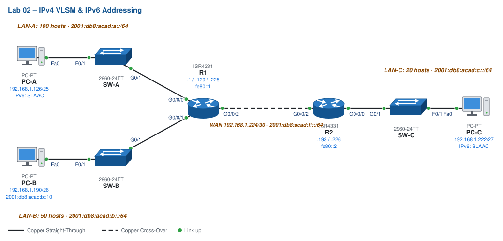

# Lab 02 – IPv4 Subnetting, VLSM & IPv6 Addressing

**Session 2 · Periods 6–10 · 225 minutes**

## Objectives

- Calculate network, broadcast, host range and number of hosts for any IPv4 prefix.
- Design a VLSM addressing scheme that meets host requirements with minimal waste.
- Configure and verify IPv4 addressing and simple static routes across two routers.
- Configure IPv6 global unicast and link-local addresses, SLAAC and IPv6 static routes.
- Use CDP, LLDP, ARP, IPv6 neighbor discovery, `ping` and `traceroute` to verify a network.

## Required Resources

| Qty | Device | Model |
|-----|--------|-------|
| 2 | Router | ISR4331 |
| 3 | Switch | 2960-24TT |
| 3 | PC | PC-PT |
| – | Cables | Copper Straight-Through, Copper Cross-Over |

## Topology



<details>
<summary>Text version of the topology</summary>

```
     LAN-A (100 hosts)                                    LAN-C (20 hosts)
  PC-A --- SW-A ---G0/0/0                        G0/0/0--- SW-C --- PC-C
                    +------+  G0/0/2    G0/0/2  +------+
                    |  R1  |--------------------|  R2  |
                    +------+   WAN (2 hosts)    +------+
  PC-B --- SW-B ---G0/0/1
     LAN-B (50 hosts)
```

</details>

Cabling (all PCs to `F0/1` of their switch, switches to routers via `G0/1`):

| From | Port | To | Port | Cable |
|------|------|----|------|-------|
| PC-A | Fa0 | SW-A | F0/1 | Straight-Through |
| SW-A | G0/1 | R1 | G0/0/0 | Straight-Through |
| PC-B | Fa0 | SW-B | F0/1 | Straight-Through |
| SW-B | G0/1 | R1 | G0/0/1 | Straight-Through |
| R1 | G0/0/2 | R2 | G0/0/2 | **Cross-Over** |
| R2 | G0/0/0 | SW-C | G0/1 | Straight-Through |
| SW-C | F0/1 | PC-C | Fa0 | Straight-Through |

---

## Period 6 – Part 1: Subnetting Drill

> 💡 **Method (the "magic number"):** find the *interesting octet* (where the mask is not 255 or 0). Block size = 256 − mask value in that octet. Networks start at multiples of the block size.
>
> Example: `192.168.5.77/27` → mask `255.255.255.224` → block = 256 − 224 = **32** → networks .0, .32, **.64**, .96 … → 77 lies in **.64**. Broadcast = next network − 1 = **.95**. Hosts = 2^(32−27) − 2 = **30**.

### Step 1: Prefix ↔ mask table

Complete the table (no calculator):

| Prefix | Subnet mask | Wildcard | Block size | Usable hosts |
|--------|-------------|----------|------------|--------------|
| /24 | 255.255.255.0 | 0.0.0.255 | 256 | 254 |
| /25 | | | | |
| /26 | | | | |
| /27 | | | | |
| /28 | | | | |
| /29 | | | | |
| /30 | | | | |
| /23 | | | | |
| /20 | | | | |

### Step 2: Analyze host addresses

For each address, find network, first usable, last usable, broadcast and usable hosts:

| # | Address | Network | First host | Last host | Broadcast | Hosts |
|---|---------|---------|-----------|-----------|-----------|-------|
| 1 | 192.168.100.77/27 | | | | | |
| 2 | 192.168.1.200/26 | | | | | |
| 3 | 172.30.1.33/30 | | | | | |
| 4 | 172.16.35.123/20 | | | | | |
| 5 | 10.10.10.10/14 | | | | | |

### Step 3: Subnetting questions

1. Divide `192.168.50.0/24` into **at least 6 equal subnets**. Which prefix do you use? List the first three subnets and the number of hosts per subnet.
2. What is the smallest prefix that supports **500 hosts**? **2 hosts**?
3. Are `10.1.1.130/25` and `10.1.1.100/25` in the same subnet? Explain.
4. How many `/26` subnets fit in a `/24`? How many `/30` subnets fit in a `/26`?

Answers: [solutions/answers.md](solutions/answers.md).

✅ **Checkpoint 1:** Instructor checks at least 3 rows of Step 2.

---

## Period 7 – Part 2: Design a VLSM Addressing Scheme

### Scenario

You have been assigned **192.168.1.0/24**. Design subnets for:

| Segment | Required hosts |
|---------|----------------|
| LAN-A (R1 G0/0/0) | 100 |
| LAN-B (R1 G0/0/1) | 50 |
| LAN-C (R2 G0/0/0) | 20 |
| WAN R1–R2 | 2 |

### Step 1: Sort requirements from largest to smallest

VLSM rule: **always allocate the largest subnet first**, starting at the beginning of the address space, so that every subnet starts on a valid boundary.

### Step 2: Fill in the VLSM worksheet

| Segment | Hosts needed | Host bits | Prefix | Network address | First usable | Last usable | Broadcast |
|---------|--------------|-----------|--------|-----------------|--------------|-------------|-----------|
| LAN-A | 100 | | | 192.168.1.0 | | | |
| LAN-B | 50 | | | | | | |
| LAN-C | 20 | | | | | | |
| WAN | 2 | | | | | | |

Address assignment rules for this lab:

- Router LAN interface = **first usable** address of the subnet.
- PC = **last usable** address of the subnet.
- WAN: R1 = first usable, R2 = last usable.

### Step 3: Fill in your addressing table

| Device | Interface | IPv4 Address | Subnet Mask | Default Gateway |
|--------|-----------|--------------|-------------|-----------------|
| R1 | G0/0/0 | | | N/A |
| R1 | G0/0/1 | | | N/A |
| R1 | G0/0/2 | | | N/A |
| R2 | G0/0/0 | | | N/A |
| R2 | G0/0/2 | | | N/A |
| PC-A | NIC | | | |
| PC-B | NIC | | | |
| PC-C | NIC | | | |

<details>
<summary><b>Check your design (open only after you finish)</b></summary>

| Segment | Prefix | Network | Usable range | Broadcast |
|---------|--------|---------|--------------|-----------|
| LAN-A | /25 (255.255.255.128) | 192.168.1.0 | .1 – .126 | .127 |
| LAN-B | /26 (255.255.255.192) | 192.168.1.128 | .129 – .190 | .191 |
| LAN-C | /27 (255.255.255.224) | 192.168.1.192 | .193 – .222 | .223 |
| WAN | /30 (255.255.255.252) | 192.168.1.224 | .225 – .226 | .227 |
| *Free* | | 192.168.1.228 – .255 | | |

| Device | Interface | IPv4 Address | Subnet Mask | Default Gateway |
|--------|-----------|--------------|-------------|-----------------|
| R1 | G0/0/0 | 192.168.1.1 | 255.255.255.128 | N/A |
| R1 | G0/0/1 | 192.168.1.129 | 255.255.255.192 | N/A |
| R1 | G0/0/2 | 192.168.1.225 | 255.255.255.252 | N/A |
| R2 | G0/0/0 | 192.168.1.193 | 255.255.255.224 | N/A |
| R2 | G0/0/2 | 192.168.1.226 | 255.255.255.252 | N/A |
| PC-A | NIC | 192.168.1.126 | 255.255.255.128 | 192.168.1.1 |
| PC-B | NIC | 192.168.1.190 | 255.255.255.192 | 192.168.1.129 |
| PC-C | NIC | 192.168.1.222 | 255.255.255.224 | 192.168.1.193 |

</details>

### Step 4: Build the topology

1. Place 2 × **4331**, 3 × **2960**, 3 × **PC**. Rename them R1, R2, SW-A, SW-B, SW-C, PC-A, PC-B, PC-C.
2. Cable them according to the cabling table above. Note the **cross-over** cable between R1 and R2.
3. Save as `lab02-<your-name>.pkt`.

✅ **Checkpoint 2:** Instructor approves the VLSM worksheet; topology cabled.

---

## Period 8 – Part 3: Configure and Verify the IPv4 Plan

### Step 1: Basic configuration on both routers

On R1 (repeat on R2 with `hostname R2`):

```
Router> enable
Router# configure terminal
Router(config)# hostname R1
R1(config)# no ip domain-lookup
R1(config)# enable secret class
R1(config)# line console 0
R1(config-line)# password cisco
R1(config-line)# login
R1(config-line)# logging synchronous
R1(config-line)# exit
R1(config)# banner motd #Lab 02 - Authorized access only#
```

### Step 2: Configure IPv4 interfaces on R1

```
R1(config)# interface g0/0/0
R1(config-if)# description LAN-A
R1(config-if)# ip address 192.168.1.1 255.255.255.128
R1(config-if)# no shutdown
R1(config-if)# interface g0/0/1
R1(config-if)# description LAN-B
R1(config-if)# ip address 192.168.1.129 255.255.255.192
R1(config-if)# no shutdown
R1(config-if)# interface g0/0/2
R1(config-if)# description WAN to R2
R1(config-if)# ip address 192.168.1.225 255.255.255.252
R1(config-if)# no shutdown
R1(config-if)# end
```

> 💡 You can jump directly from one `interface` to another without typing `exit`.

### Step 3: Configure IPv4 interfaces on R2

```
R2(config)# interface g0/0/0
R2(config-if)# description LAN-C
R2(config-if)# ip address 192.168.1.193 255.255.255.224
R2(config-if)# no shutdown
R2(config-if)# interface g0/0/2
R2(config-if)# description WAN to R1
R2(config-if)# ip address 192.168.1.226 255.255.255.252
R2(config-if)# no shutdown
R2(config-if)# end
```

### Step 4: Configure the PCs

Use the values from your addressing table (Desktop → IP Configuration → Static).

### Step 5: Test local connectivity

| From | To | Expected |
|------|-----|----------|
| PC-A | 192.168.1.1 | ✅ |
| PC-B | 192.168.1.129 | ✅ |
| PC-C | 192.168.1.193 | ✅ |
| R1 | `ping 192.168.1.226` | ✅ |
| PC-A | PC-C (192.168.1.222) | ❌ **fails** – why? |

```
R1# show ip route
     192.168.1.0/24 is variably subnetted, 6 subnets, 4 masks
C       192.168.1.0/25 is directly connected, GigabitEthernet0/0/0
L       192.168.1.1/32 is directly connected, GigabitEthernet0/0/0
C       192.168.1.128/26 is directly connected, GigabitEthernet0/0/1
L       192.168.1.129/32 is directly connected, GigabitEthernet0/0/1
C       192.168.1.224/30 is directly connected, GigabitEthernet0/0/2
L       192.168.1.225/32 is directly connected, GigabitEthernet0/0/2
```

R1 has no route to `192.168.1.192/27`, and R2 has no route back to LAN-A/LAN-B.

### Step 6: Add static routes (preview of Lab 5)

```
R1(config)# ip route 192.168.1.192 255.255.255.224 192.168.1.226
R2(config)# ip route 0.0.0.0 0.0.0.0 192.168.1.225
```

> 💡 R1 gets a **specific** route to LAN-C. R2 is a "stub" router – everything not local goes to R1, so a single **default route** (`0.0.0.0/0`) is enough.

### Step 7: Verify end-to-end IPv4 connectivity

```
R1# show ip route static
S       192.168.1.192/27 [1/0] via 192.168.1.226
R2# show ip route
Gateway of last resort is 192.168.1.225 to network 0.0.0.0
S*   0.0.0.0/0 [1/0] via 192.168.1.225
```

From PC-A: `ping 192.168.1.222` and `tracert 192.168.1.222` → hops `192.168.1.1`, `192.168.1.226`, `192.168.1.222`.

✅ **Checkpoint 3:** All three PCs can ping each other over IPv4.

---

## Period 9 – Part 4: Configure IPv6 Addressing

### IPv6 Addressing Table

| Device | Interface | IPv6 Address / Prefix | Link-Local | Default Gateway |
|--------|-----------|-----------------------|------------|-----------------|
| R1 | G0/0/0 | 2001:db8:acad:a::1/64 | fe80::1 | N/A |
| R1 | G0/0/1 | 2001:db8:acad:b::1/64 | fe80::1 | N/A |
| R1 | G0/0/2 | 2001:db8:acad:ff::1/64 | fe80::1 | N/A |
| R2 | G0/0/0 | 2001:db8:acad:c::1/64 | fe80::2 | N/A |
| R2 | G0/0/2 | 2001:db8:acad:ff::2/64 | fe80::2 | N/A |
| PC-A | NIC | SLAAC (Automatic) | EUI-64 | fe80::1 |
| PC-B | NIC | 2001:db8:acad:b::10/64 | EUI-64 | fe80::1 |
| PC-C | NIC | SLAAC (Automatic) | EUI-64 | fe80::2 |

> 💡 IPv6 rules to remember: 128 bits, 8 hextets; leading zeros in a hextet can be omitted; one run of all-zero hextets can be replaced by `::`. Example: `2001:0db8:acad:000a:0000:0000:0000:0001` = `2001:db8:acad:a::1`.

### Step 1: Enable IPv6 routing

```
R1(config)# ipv6 unicast-routing
R2(config)# ipv6 unicast-routing
```

> ⚠️ Without this command the router does **not** forward IPv6 packets and does **not** send Router Advertisements (RAs), so SLAAC will not work.

### Step 2: Configure IPv6 on R1

```
R1(config)# interface g0/0/0
R1(config-if)# ipv6 address 2001:db8:acad:a::1/64
R1(config-if)# ipv6 address fe80::1 link-local
R1(config-if)# interface g0/0/1
R1(config-if)# ipv6 address 2001:db8:acad:b::1/64
R1(config-if)# ipv6 address fe80::1 link-local
R1(config-if)# interface g0/0/2
R1(config-if)# ipv6 address 2001:db8:acad:ff::1/64
R1(config-if)# ipv6 address fe80::1 link-local
R1(config-if)# end
```

> 💡 The same link-local address can be reused on every interface of a router, because link-local addresses are only significant on their own link. Static link-locals make gateways easy to remember.

### Step 3: Configure IPv6 on R2

```
R2(config)# interface g0/0/0
R2(config-if)# ipv6 address 2001:db8:acad:c::1/64
R2(config-if)# ipv6 address fe80::2 link-local
R2(config-if)# interface g0/0/2
R2(config-if)# ipv6 address 2001:db8:acad:ff::2/64
R2(config-if)# ipv6 address fe80::2 link-local
R2(config-if)# end
```

### Step 4: Verify the router interfaces

```
R1# show ipv6 interface brief
GigabitEthernet0/0/0       [up/up]
    FE80::1
    2001:DB8:ACAD:A::1
...
R1# show ipv6 interface g0/0/0
  ...Joined group address(es):
    FF02::1          ! all-nodes
    FF02::2          ! all-routers (present because ipv6 unicast-routing is on)
    FF02::1:FF00:1   ! solicited-node multicast
```

### Step 5: Configure the PCs

- **PC-A** and **PC-C**: Desktop → IP Configuration → IPv6 Configuration → **Automatic**. Wait a few seconds – an address with prefix `2001:db8:acad:a::` (PC-A) appears, and the gateway becomes `FE80::1`.
- **PC-B**: **Static** → IPv6 Address `2001:db8:acad:b::10` / `64`, IPv6 Gateway `fe80::1`.

On PC-A: `ipconfig /all` – note how the interface ID was created from the MAC address (EUI-64: MAC split in half, `FFFE` inserted, 7th bit flipped).

### Step 6: Configure IPv6 static routes

```
R1(config)# ipv6 route 2001:db8:acad:c::/64 2001:db8:acad:ff::2
R2(config)# ipv6 route ::/0 2001:db8:acad:ff::1
```

### Step 7: Verify IPv6 end to end

```
R1# show ipv6 route
S   2001:DB8:ACAD:C::/64 [1/0]
     via 2001:DB8:ACAD:FF::2
...
```

From PC-A:

```
C:\> ping 2001:db8:acad:b::10
C:\> ping <PC-C IPv6 address from its ipconfig>
C:\> tracert <PC-C IPv6 address>
```

✅ **Checkpoint 4:** All PCs can ping each other over both IPv4 and IPv6.

---

## Period 10 – Part 5: Verification Tools and Troubleshooting

### Step 1: CDP (Cisco Discovery Protocol)

```
R1# show cdp neighbors
Device ID    Local Intrfce   Holdtme    Capability   Platform    Port ID
R2           Gig 0/0/2       150            R        ISR4300     Gig 0/0/2
SW-A         Gig 0/0/0       150            S        2960        Gig 0/1
SW-B         Gig 0/0/1       150            S        2960        Gig 0/1

R1# show cdp neighbors detail      ! includes the neighbor's IP address and IOS version
```

> ⚠️ CDP reveals device information to anyone connected. Disable it on untrusted interfaces:
> ```
> R1(config)# interface g0/0/0
> R1(config-if)# no cdp enable
> ```
> Re-enable it afterwards with `cdp enable` (and globally with `cdp run`).

### Step 2: LLDP (vendor-neutral, IEEE 802.1AB)

```
R1(config)# lldp run
R2(config)# lldp run
R1# show lldp neighbors
R1# show lldp neighbors detail
```

### Step 3: Address resolution tables

```
R1# show arp
Protocol  Address          Age (min)  Hardware Addr   Type   Interface
Internet  192.168.1.1             -   0001.4245.xxxx  ARPA   GigabitEthernet0/0/0
Internet  192.168.1.126           2   0060.2f3a.xxxx  ARPA   GigabitEthernet0/0/0
...
R1# show ipv6 neighbors
C:\> arp -a                         ! on PC-A
```

> 💡 IPv4 uses **ARP** (broadcast); IPv6 uses **Neighbor Discovery** NS/NA messages (solicited-node multicast).

### Step 4: Extended ping and traceroute from the router

```
R1# ping
Protocol [ip]:
Target IP address: 192.168.1.222
Repeat count [5]: 10
Datagram size [100]: 1500
Timeout in seconds [2]:
Extended commands [n]: y
Source address or interface: 192.168.1.1
...
R1# traceroute 192.168.1.222
R1# ping ipv6 2001:db8:acad:c::1
```

> 💡 Sourcing the ping from `192.168.1.1` (the LAN-A gateway) tests whether R2 has a route **back** to LAN-A – a common hidden problem.

### Step 5: Troubleshooting challenge

Your instructor (or your lab partner) will introduce **3** of the faults below into your file. Find and fix them using only `show` commands, `ping` and `tracert`. Record each fault in your report.

| # | Possible fault |
|---|----------------|
| F1 | PC-B subnet mask changed to `255.255.255.0` |
| F2 | R2 default route removed |
| F3 | PC-C default gateway set to `192.168.1.194` |
| F4 | R1 `G0/0/2` IP changed to `192.168.1.229/30` |
| F5 | `no ipv6 unicast-routing` on R2 |
| F6 | R1 `G0/0/1` administratively shut down |

### Challenge (Extra credit)

The company adds **LAN-D with 10 hosts** on R2 `G0/0/1`. Allocate it from the free space, configure it (IPv4 + IPv6 `2001:db8:acad:d::/64`), and update routing so that every PC can reach a PC in LAN-D.

## Review Questions

1. Why must the largest subnet be allocated first in VLSM?
2. How many addresses are wasted in each subnet of your design? What would be the waste if you had used `/25` for every segment?
3. What is the purpose of the IPv6 link-local address? Can a router forward packets with a link-local destination?
4. Why is `ipv6 unicast-routing` needed for SLAAC to work?
5. What is the difference between CDP and LLDP?
6. Why did the first ping from PC-A to PC-C sometimes lose the first packet?

Answers and final configurations: [solutions/](solutions/).
