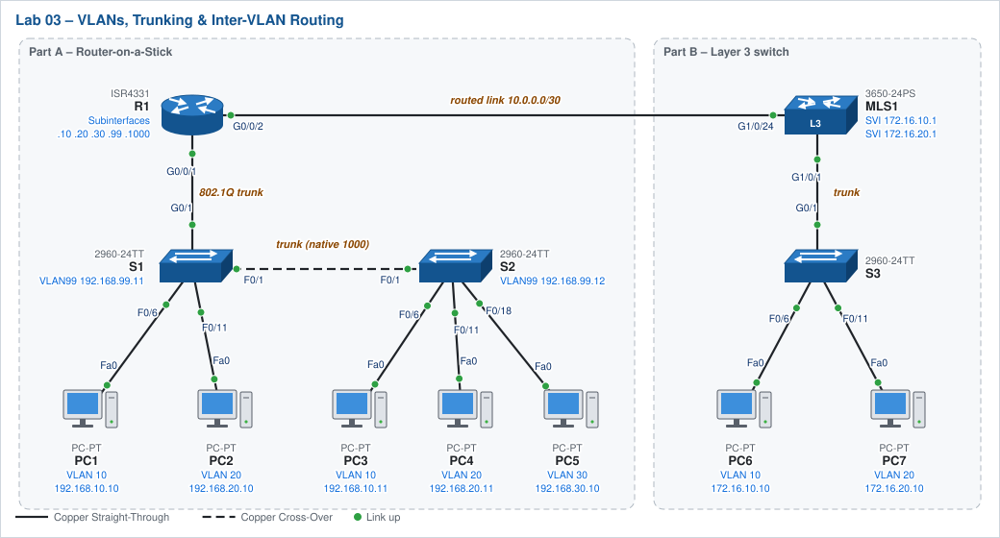

# Lab 03 – VLANs, Trunking & Inter-VLAN Routing

**Session 3 · Periods 11–15 · 225 minutes**

## Objectives

- Create and name VLANs and assign switch access ports to them.
- Configure 802.1Q trunks with a dedicated native VLAN and an allowed-VLAN list; control DTP.
- Route between VLANs with **Router-on-a-Stick** (802.1Q subinterfaces).
- Route between VLANs with a **Layer 3 switch** (SVIs, `ip routing`, routed port).
- Troubleshoot common VLAN and trunk problems.

## Required Resources

| Qty | Device | Model |
|-----|--------|-------|
| 1 | Router | ISR4331 |
| 3 | Switch | 2960-24TT |
| 1 | Multilayer switch | 3650-24PS |
| 7 | PC | PC-PT |

## Topology



<details>
<summary>Text version of the topology</summary>

```
        Part A – Router-on-a-Stick                 Part B – Layer 3 switch (Period 14)

               +------+  G0/0/2     10.0.0.0/30     G1/0/24  +-------+
               |  R1  |--------------------------------------| MLS1  |
               +------+       (routed link)                  +-------+
              G0/0/1 (trunk)                              G1/0/1 (trunk)
                 |                                             |
               G0/1                                          G0/1
               +------+  F0/1    F0/1  +------+             +------+
               |  S1  |----------------|  S2  |             |  S3  |
               +------+    (trunk)     +------+             +------+
             F0/6   F0/11        F0/6  F0/11  F0/18        F0/6   F0/11
              |       |           |      |      |           |       |
             PC1     PC2         PC3    PC4    PC5         PC6     PC7
            (V10)   (V20)       (V10)  (V20)  (V30)       (V10)   (V20)
```

</details>

## VLAN Table

| VLAN | Name | Subnet (Part A) | Ports |
|------|------|-----------------|-------|
| 10 | SALES | 192.168.10.0/24 | S1 F0/6, S2 F0/6 |
| 20 | ENGINEERING | 192.168.20.0/24 | S1 F0/11, S2 F0/11 |
| 30 | IT | 192.168.30.0/24 | S2 F0/18 |
| 99 | MANAGEMENT | 192.168.99.0/24 | Switch SVIs |
| 999 | PARKING | – | All unused ports |
| 1000 | NATIVE | – | Native VLAN on trunks |

## Addressing Table

| Device | Interface | IPv4 Address | Subnet Mask | Default Gateway |
|--------|-----------|--------------|-------------|-----------------|
| R1 | G0/0/1.10 | 192.168.10.1 | 255.255.255.0 | N/A |
| R1 | G0/0/1.20 | 192.168.20.1 | 255.255.255.0 | N/A |
| R1 | G0/0/1.30 | 192.168.30.1 | 255.255.255.0 | N/A |
| R1 | G0/0/1.99 | 192.168.99.1 | 255.255.255.0 | N/A |
| R1 | G0/0/2 | 10.0.0.1 | 255.255.255.252 | N/A |
| S1 | VLAN 99 | 192.168.99.11 | 255.255.255.0 | 192.168.99.1 |
| S2 | VLAN 99 | 192.168.99.12 | 255.255.255.0 | 192.168.99.1 |
| PC1 | NIC | 192.168.10.10 | 255.255.255.0 | 192.168.10.1 |
| PC2 | NIC | 192.168.20.10 | 255.255.255.0 | 192.168.20.1 |
| PC3 | NIC | 192.168.10.11 | 255.255.255.0 | 192.168.10.1 |
| PC4 | NIC | 192.168.20.11 | 255.255.255.0 | 192.168.20.1 |
| PC5 | NIC | 192.168.30.10 | 255.255.255.0 | 192.168.30.1 |
| MLS1 | VLAN 10 | 172.16.10.1 | 255.255.255.0 | N/A |
| MLS1 | VLAN 20 | 172.16.20.1 | 255.255.255.0 | N/A |
| MLS1 | G1/0/24 | 10.0.0.2 | 255.255.255.252 | N/A |
| PC6 | NIC | 172.16.10.10 | 255.255.255.0 | 172.16.10.1 |
| PC7 | NIC | 172.16.20.10 | 255.255.255.0 | 172.16.20.1 |

---

## Period 11 – Part 1: Build the Network, Create VLANs and Assign Ports

### Step 1: Build Part A of the topology

Place R1, S1, S2, PC1–PC5. Cable:

| From | Port | To | Port | Cable |
|------|------|----|------|-------|
| R1 | G0/0/1 | S1 | G0/1 | Straight-Through |
| S1 | F0/1 | S2 | F0/1 | **Cross-Over** |
| PC1 | Fa0 | S1 | F0/6 | Straight-Through |
| PC2 | Fa0 | S1 | F0/11 | Straight-Through |
| PC3 | Fa0 | S2 | F0/6 | Straight-Through |
| PC4 | Fa0 | S2 | F0/11 | Straight-Through |
| PC5 | Fa0 | S2 | F0/18 | Straight-Through |

Configure all PCs with the IP settings in the addressing table.

### Step 2: Basic switch configuration

On S1 (repeat on S2 with `hostname S2`):

```
Switch(config)# hostname S1
S1(config)# no ip domain-lookup
S1(config)# enable secret class
S1(config)# line console 0
S1(config-line)# password cisco
S1(config-line)# login
S1(config-line)# logging synchronous
S1(config-line)# exit
```

### Step 3: Observe the default VLAN state

```
S1# show vlan brief
VLAN Name                             Status    Ports
---- -------------------------------- --------- -------------------------------
1    default                          active    Fa0/1, Fa0/2, ... Gig0/1, Gig0/2
1002 fddi-default                     act/unsup
...
```

> 💡 By default every port is an access port in **VLAN 1**. All devices are in one broadcast domain.

### Step 4: Create and name the VLANs (on S1 **and** S2)

```
S1(config)# vlan 10
S1(config-vlan)# name SALES
S1(config-vlan)# vlan 20
S1(config-vlan)# name ENGINEERING
S1(config-vlan)# vlan 30
S1(config-vlan)# name IT
S1(config-vlan)# vlan 99
S1(config-vlan)# name MANAGEMENT
S1(config-vlan)# vlan 999
S1(config-vlan)# name PARKING
S1(config-vlan)# vlan 1000
S1(config-vlan)# name NATIVE
S1(config-vlan)# end
```

> 💡 VLANs 1–1005 are stored in `flash:vlan.dat`, not in the running-config.

### Step 5: Assign access ports

S1:

```
S1(config)# interface f0/6
S1(config-if)# switchport mode access
S1(config-if)# switchport access vlan 10
S1(config-if)# interface f0/11
S1(config-if)# switchport mode access
S1(config-if)# switchport access vlan 20
S1(config-if)# exit
```

S2:

```
S2(config)# interface f0/6
S2(config-if)# switchport mode access
S2(config-if)# switchport access vlan 10
S2(config-if)# interface f0/11
S2(config-if)# switchport mode access
S2(config-if)# switchport access vlan 20
S2(config-if)# interface f0/18
S2(config-if)# switchport mode access
S2(config-if)# switchport access vlan 30
S2(config-if)# exit
```

### Step 6: Park and disable unused ports

S1 (used ports: F0/1, F0/6, F0/11, G0/1):

```
S1(config)# interface range f0/2 - 5 , f0/7 - 10 , f0/12 - 24 , g0/2
S1(config-if-range)# switchport mode access
S1(config-if-range)# switchport access vlan 999
S1(config-if-range)# shutdown
S1(config-if-range)# end
```

S2 (used ports: F0/1, F0/6, F0/11, F0/18):

```
S2(config)# interface range f0/2 - 5 , f0/7 - 10 , f0/12 - 17 , f0/19 - 24 , g0/1 - 2
S2(config-if-range)# switchport mode access
S2(config-if-range)# switchport access vlan 999
S2(config-if-range)# shutdown
S2(config-if-range)# end
```

### Step 7: Verify and test

```
S1# show vlan brief
10   SALES                            active    Fa0/6
20   ENGINEERING                      active    Fa0/11
30   IT                               active
99   MANAGEMENT                       active
999  PARKING                          active    Fa0/2, Fa0/3, ...
1000 NATIVE                           active
```

Test from PC1: `ping 192.168.10.11` (PC3 – same VLAN, other switch) → ❌ **fails**.

Why? Check the S1–S2 link:

```
S1# show interfaces f0/1 switchport
Name: Fa0/1
Switchport: Enabled
Administrative Mode: dynamic auto
Operational Mode: static access
Access Mode VLAN: 1 (default)
```

Both sides are **dynamic auto**, so DTP does not form a trunk – the link is an access link in VLAN 1 and carries no VLAN 10 traffic.

✅ **Checkpoint 1:** `show vlan brief` matches the VLAN table on both switches; you can explain why PC1 can't reach PC3.

---

## Period 12 – Part 2: Configure 802.1Q Trunks

### Step 1: Observe DTP negotiation

```
S1(config)# interface f0/1
S1(config-if)# switchport mode dynamic desirable
S1(config-if)# end
S1# show interfaces trunk
Port        Mode         Encapsulation  Status        Native vlan
Fa0/1       desirable    802.1q         trunking      1
```

> 💡 DTP mode combinations:
>
> | | dynamic auto | dynamic desirable | trunk | access |
> |---|---|---|---|---|
> | **dynamic auto** | access | trunk | trunk | access |
> | **dynamic desirable** | trunk | trunk | trunk | access |
> | **trunk** | trunk | trunk | trunk | ⚠️ mismatch |
> | **access** | access | access | ⚠️ mismatch | access |

PC1 → PC3 ping now succeeds. But DTP is a security risk (an attacker can negotiate a trunk – *VLAN hopping*). Best practice: **static trunk + no negotiation**.

### Step 2: Configure static trunks on S1

```
S1(config)# interface range f0/1 , g0/1
S1(config-if-range)# switchport mode trunk
S1(config-if-range)# switchport trunk native vlan 1000
S1(config-if-range)# switchport trunk allowed vlan 10,20,30,99,1000
S1(config-if-range)# switchport nonegotiate
S1(config-if-range)# end
```

You will briefly see:

```
%CDP-4-NATIVE_VLAN_MISMATCH: Native VLAN mismatch discovered on FastEthernet0/1 (1000), with S2 FastEthernet0/1 (1).
```

This is expected until S2 is configured.

### Step 3: Configure the trunk on S2

```
S2(config)# interface f0/1
S2(config-if)# switchport mode trunk
S2(config-if)# switchport trunk native vlan 1000
S2(config-if)# switchport trunk allowed vlan 10,20,30,99,1000
S2(config-if)# switchport nonegotiate
S2(config-if)# end
```

### Step 4: Verify the trunks

```
S1# show interfaces trunk
Port        Mode         Encapsulation  Status        Native vlan
Fa0/1       on           802.1q         trunking      1000
Gig0/1      on           802.1q         trunking      1000

Port        Vlans allowed on trunk
Fa0/1       10,20,30,99,1000
Gig0/1      10,20,30,99,1000

Port        Vlans allowed and active in management domain
Fa0/1       10,20,30,99,1000
...
Port        Vlans in spanning tree forwarding state and not pruned
Fa0/1       10,20,30,99,1000
```

> ⚠️ `G0/1` on S1 shows *trunking* even though R1 is not configured yet – routers don't run DTP; the switch side is forced to trunk.

> ⚠️ `switchport trunk allowed vlan 10,20` **replaces** the list. To add a VLAN later use `switchport trunk allowed vlan add 40`.

### Step 5: Configure the management SVIs

S1:

```
S1(config)# interface vlan 99
S1(config-if)# ip address 192.168.99.11 255.255.255.0
S1(config-if)# no shutdown
S1(config-if)# exit
S1(config)# ip default-gateway 192.168.99.1
```

S2: same with `192.168.99.12`.

Test: `S1# ping 192.168.99.12` → ✅ (VLAN 99 crosses the trunk).

### Step 6: Test intra-VLAN connectivity

| From | To | Expected now |
|------|----|--------------|
| PC1 (V10) | PC3 192.168.10.11 (V10) | ✅ |
| PC2 (V20) | PC4 192.168.20.11 (V20) | ✅ |
| PC1 (V10) | PC2 192.168.20.10 (V20) | ❌ – no router yet |

✅ **Checkpoint 2:** Static trunks with native VLAN 1000; hosts in the same VLAN communicate across switches.

---

## Period 13 – Part 3: Router-on-a-Stick Inter-VLAN Routing

> 💡 A single physical router interface is divided into **subinterfaces**, one per VLAN. Each subinterface has `encapsulation dot1Q <vlan-id>` and acts as the default gateway for that VLAN.

### Step 1: Basic configuration of R1

```
Router(config)# hostname R1
R1(config)# no ip domain-lookup
R1(config)# enable secret class
R1(config)# line console 0
R1(config-line)# password cisco
R1(config-line)# login
R1(config-line)# logging synchronous
R1(config-line)# exit
```

### Step 2: Configure the subinterfaces

```
R1(config)# interface g0/0/1.10
R1(config-subif)# description Gateway for VLAN 10 SALES
R1(config-subif)# encapsulation dot1Q 10
R1(config-subif)# ip address 192.168.10.1 255.255.255.0
R1(config-subif)# interface g0/0/1.20
R1(config-subif)# description Gateway for VLAN 20 ENGINEERING
R1(config-subif)# encapsulation dot1Q 20
R1(config-subif)# ip address 192.168.20.1 255.255.255.0
R1(config-subif)# interface g0/0/1.30
R1(config-subif)# description Gateway for VLAN 30 IT
R1(config-subif)# encapsulation dot1Q 30
R1(config-subif)# ip address 192.168.30.1 255.255.255.0
R1(config-subif)# interface g0/0/1.99
R1(config-subif)# description Gateway for VLAN 99 MANAGEMENT
R1(config-subif)# encapsulation dot1Q 99
R1(config-subif)# ip address 192.168.99.1 255.255.255.0
R1(config-subif)# interface g0/0/1.1000
R1(config-subif)# description Native VLAN - no IP
R1(config-subif)# encapsulation dot1Q 1000 native
R1(config-subif)# exit
```

> ⚠️ You must enter `encapsulation dot1Q` **before** `ip address` on a subinterface, otherwise IOS rejects the address.

### Step 3: Enable the physical interface

```
R1(config)# interface g0/0/1
R1(config-if)# description Trunk to S1 G0/1
R1(config-if)# no shutdown
R1(config-if)# end
```

> 💡 The physical interface has **no IP address**. Shutting it down disables all its subinterfaces.

### Step 4: Verify

```
R1# show ip interface brief
GigabitEthernet0/0/1      unassigned      YES unset  up      up
GigabitEthernet0/0/1.10   192.168.10.1    YES manual up      up
GigabitEthernet0/0/1.20   192.168.20.1    YES manual up      up
GigabitEthernet0/0/1.30   192.168.30.1    YES manual up      up
GigabitEthernet0/0/1.99   192.168.99.1    YES manual up      up
GigabitEthernet0/0/1.1000 unassigned      YES unset  up      up

R1# show running-config | include encapsulation   ! one dot1Q line per subinterface
R1# show ip route connected
```

### Step 5: Test inter-VLAN routing

| From | To | Expected |
|------|----|----------|
| PC1 (V10) | PC2 192.168.20.10 | ✅ |
| PC1 (V10) | PC5 192.168.30.10 | ✅ |
| PC4 (V20) | S1 192.168.99.11 | ✅ |
| PC5 | `tracert 192.168.10.10` | 2 hops via 192.168.30.1 |

### Step 6: Follow a frame in Simulation mode

1. Simulation mode, filter **ICMP** only. Send a PDU from **PC3** to **PC2**.
2. Click the packet on the S2 → S1 link: look at the **802.1Q** header – VLAN ID 10.
3. Click the packet on the R1 → S1 link (returning out of R1): VLAN ID **20**.
4. Record in your report the number of times the packet crossed the S1–R1 link.

✅ **Checkpoint 3:** Every PC can ping every other PC and both switch SVIs.

---

## Period 14 – Part 4: Inter-VLAN Routing with a Layer 3 Switch

Router-on-a-Stick is limited by the bandwidth of one physical link. Enterprise networks use **multilayer switches** that route in hardware using **SVIs**.

### Step 1: Add the Part B devices

1. Place a **3650-24PS** (rename **MLS1**), a **2960** (**S3**) and two PCs (**PC6**, **PC7**).
2. ⚠️ The 3650 ships **without a power supply** in Packet Tracer: click **MLS1 → Physical**, drag **AC-POWER-SUPPLY** into the empty power slot on the rear panel. The device boots.
   Also insert a **GLC-T** module into **R1 G0/0/2** (see the warning below) before cabling R1 to MLS1.
3. Cable:

> ⚠️ **G0/0/2 needs a transceiver.** On the ISR4331 in Packet Tracer, `GigabitEthernet0/0/2` is an empty **SFP slot**
> (it does not appear in the cable's port list). For each router that uses G0/0/2: click the router → **Physical** tab →
> **Zoom In** twice → select **GLC-T** in the MODULES list → drag the module picture (bottom-right) onto the slot
> labelled **GE 0/0/2** (bottom-right port of the port block). No power-off is needed. G0/0/2 then accepts copper cables.


| From | Port | To | Port | Cable |
|------|------|----|------|-------|
| MLS1 | G1/0/1 | S3 | G0/1 | Straight-Through |
| MLS1 | G1/0/24 | R1 | G0/0/2 | Straight-Through |
| PC6 | Fa0 | S3 | F0/6 | Straight-Through |
| PC7 | Fa0 | S3 | F0/11 | Straight-Through |

4. Configure PC6 and PC7 from the addressing table.

### Step 2: Configure S3 (access switch)

```
Switch(config)# hostname S3
S3(config)# vlan 10
S3(config-vlan)# name SALES
S3(config-vlan)# vlan 20
S3(config-vlan)# name ENGINEERING
S3(config-vlan)# exit
S3(config)# interface f0/6
S3(config-if)# switchport mode access
S3(config-if)# switchport access vlan 10
S3(config-if)# interface f0/11
S3(config-if)# switchport mode access
S3(config-if)# switchport access vlan 20
S3(config-if)# interface g0/1
S3(config-if)# switchport mode trunk
S3(config-if)# end
```

### Step 3: Configure VLANs and the trunk on MLS1

```
Switch(config)# hostname MLS1
MLS1(config)# vlan 10
MLS1(config-vlan)# name SALES
MLS1(config-vlan)# vlan 20
MLS1(config-vlan)# name ENGINEERING
MLS1(config-vlan)# exit
MLS1(config)# interface g1/0/1
MLS1(config-if)# switchport mode trunk
MLS1(config-if)# exit
```

> 💡 The 3650 supports only 802.1Q, so `switchport mode trunk` is all it needs. Older multilayer switches that also
> support ISL (such as the 3560) require `switchport trunk encapsulation dot1q` first – on the 3650 in Packet Tracer
> that command is rejected with `% Invalid input`.

### Step 4: Configure the SVIs and enable routing

```
MLS1(config)# interface vlan 10
MLS1(config-if)# description Gateway VLAN 10
MLS1(config-if)# ip address 172.16.10.1 255.255.255.0
MLS1(config-if)# no shutdown
MLS1(config-if)# interface vlan 20
MLS1(config-if)# description Gateway VLAN 20
MLS1(config-if)# ip address 172.16.20.1 255.255.255.0
MLS1(config-if)# no shutdown
MLS1(config-if)# exit
MLS1(config)# ip routing
```

> ⚠️ `ip routing` is **disabled by default** on a Layer 3 switch. Without it, the SVIs exist but the switch will not route between them.

Test: PC6 → PC7 (`ping 172.16.20.10`) ✅.

### Step 5: Configure a routed port toward R1

```
MLS1(config)# interface g1/0/24
MLS1(config-if)# description Routed link to R1
MLS1(config-if)# no switchport
MLS1(config-if)# ip address 10.0.0.2 255.255.255.252
MLS1(config-if)# no shutdown
MLS1(config-if)# exit
MLS1(config)# ip route 192.168.0.0 255.255.0.0 10.0.0.1
```

On R1:

```
R1(config)# interface g0/0/2
R1(config-if)# description Routed link to MLS1
R1(config-if)# ip address 10.0.0.1 255.255.255.252
R1(config-if)# no shutdown
R1(config-if)# exit
R1(config)# ip route 172.16.0.0 255.255.0.0 10.0.0.2
```

> 💡 `no switchport` turns a switch port into a Layer 3 interface, like a router port. It belongs to no VLAN.

### Step 6: Verify

```
MLS1# show ip interface brief
MLS1# show ip route
C    10.0.0.0/30 is directly connected, GigabitEthernet1/0/24
C    172.16.10.0/24 is directly connected, Vlan10
C    172.16.20.0/24 is directly connected, Vlan20
S    192.168.0.0/16 [1/0] via 10.0.0.1
MLS1# show interfaces g1/0/24 switchport
Switchport: Disabled
```

From PC6: `ping 192.168.10.10` (PC1) and `tracert 192.168.30.10` (PC5) → path 172.16.10.1 → 10.0.0.1 → 192.168.30.10.

✅ **Checkpoint 4:** PC6/PC7 reach each other through MLS1, and reach all Part A PCs through R1.

---

## Period 15 – Part 5: Troubleshooting and Review

### Step 1: Useful verification commands

| Command | What to look for |
|---------|------------------|
| `show vlan brief` | Port in the right VLAN? VLAN exists? |
| `show interfaces trunk` | Trunk up? Native VLAN matches? VLAN allowed **and** active? |
| `show interfaces f0/6 switchport` | Administrative vs. operational mode, access VLAN |
| `show ip interface brief` (R1) | Subinterfaces up/up? |
| `show running-config interface g0/0/1.20` | Correct `encapsulation dot1Q` ID? |
| `show mac address-table` | Which MACs learned on which ports and VLANs |

### Step 2: Troubleshooting challenge

Your instructor will introduce **3** faults. Diagnose with show commands only; record *symptom → command → cause → fix*.

| # | Possible fault |
|---|----------------|
| F1 | S2 F0/11 assigned to VLAN 10 |
| F2 | VLAN 30 removed from the allowed list on S1 F0/1 |
| F3 | S2 F0/1 native VLAN set back to 1 |
| F4 | R1 subinterface G0/0/1.20 uses `encapsulation dot1Q 21` |
| F5 | VLAN 20 deleted from S2 (`no vlan 20`) |
| F6 | S1 G0/1 changed to `switchport mode access` |
| F7 | `no ip routing` on MLS1 |

> 💡 F5 is tricky: after deleting a VLAN, its ports stay assigned to it but become **inactive** (they disappear from `show vlan brief`). Recreating the VLAN fixes it.

### Challenge (Extra credit)

1. Add **VLAN 40 GUEST (192.168.40.0/24)** on S1 port F0/20 with a new PC. Make it reachable from all other VLANs. Remember: VLAN database on both switches? Allowed list? Subinterface?
2. Configure S3 with a management SVI in VLAN 10 so that it can be pinged from PC1.

## Review Questions

1. What are three benefits of VLANs?
2. Why is it recommended to change the native VLAN away from VLAN 1 and to use `switchport nonegotiate`?
3. What happens to untagged frames received on a trunk port?
4. Compare Router-on-a-Stick and Layer 3 switch inter-VLAN routing (performance, cost, scalability).
5. What two commands are needed on a 3650 before a port can route between VLANs using SVIs? What does `no switchport` do?
6. Why must the physical router interface `G0/0/1` have no IP address in Router-on-a-Stick?

Answers and final configurations: [solutions/](solutions/).
