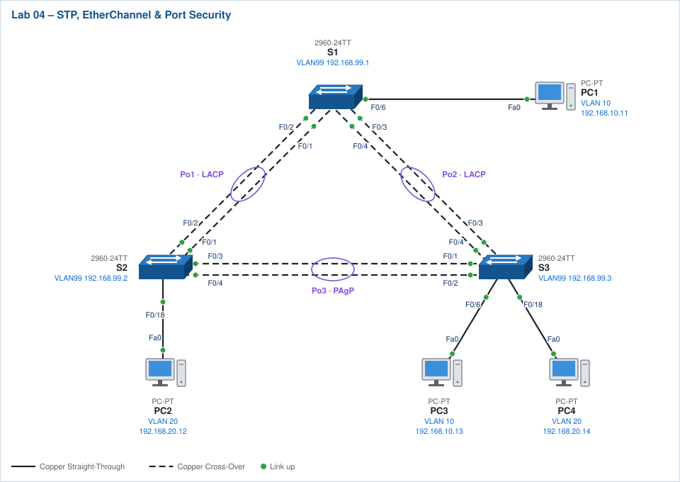

# Lab 04 – STP, EtherChannel & Port Security

**Session 4 · Periods 16–20 · 225 minutes**

## Objectives

- Observe how PVST+ elects a root bridge and assigns port roles and states.
- Influence the STP topology with bridge priority and port cost; enable Rapid PVST+.
- Protect the STP topology with PortFast and BPDU Guard.
- Bundle redundant links with EtherChannel using LACP and PAgP.
- Secure access ports with port security and park unused ports.

## Required Resources

| Qty | Device | Model |
|-----|--------|-------|
| 3 | Switch | 2960-24TT |
| 1 | Switch (rogue, Part 2) | 2960-24TT |
| 4 | PC | PC-PT |
| 1 | Laptop (attacker, Part 4) | Laptop-PT |

## Topology



<details>
<summary>Text version of the topology</summary>

```
                              +------+
                              |  S1  |
                              +------+
                   F0/1 F0/2 //      \\ F0/3 F0/4
                            //  Po1  Po2 \\
                   F0/1 F0/2//          \\ F0/3 F0/4
                     +------+   Po3      +------+
                     |  S2  |============|  S3  |
                     +------+ F0/3   F0/1+------+
                              F0/4   F0/2
       PC1 on S1 F0/6 (VLAN 10)        PC3 on S3 F0/6  (VLAN 10)
       PC2 on S2 F0/18 (VLAN 20)       PC4 on S3 F0/18 (VLAN 20)
```

</details>

Inter-switch cabling (all **Copper Cross-Over**):

| Link | From | To | Future EtherChannel |
|------|------|----|---------------------|
| 1 | S1 F0/1 | S2 F0/1 | Po1 – LACP |
| 2 | S1 F0/2 | S2 F0/2 | Po1 – LACP |
| 3 | S1 F0/3 | S3 F0/3 | Po2 – LACP |
| 4 | S1 F0/4 | S3 F0/4 | Po2 – LACP |
| 5 | S2 F0/3 | S3 F0/1 | Po3 – PAgP |
| 6 | S2 F0/4 | S3 F0/2 | Po3 – PAgP |

## Addressing Table

| Device | Interface | IPv4 Address | Subnet Mask | VLAN |
|--------|-----------|--------------|-------------|------|
| S1 | VLAN 99 | 192.168.99.1 | 255.255.255.0 | 99 |
| S2 | VLAN 99 | 192.168.99.2 | 255.255.255.0 | 99 |
| S3 | VLAN 99 | 192.168.99.3 | 255.255.255.0 | 99 |
| PC1 | NIC | 192.168.10.11 | 255.255.255.0 | 10 |
| PC2 | NIC | 192.168.20.12 | 255.255.255.0 | 20 |
| PC3 | NIC | 192.168.10.13 | 255.255.255.0 | 10 |
| PC4 | NIC | 192.168.20.14 | 255.255.255.0 | 20 |

VLANs: **10 STAFF**, **20 VOICE-LAB**, **99 MANAGEMENT**, **999 PARKING**, **1000 NATIVE**.

> 💡 No router is needed in this lab – we test only Layer 2 (same-VLAN pings and switch SVIs).

---

## Period 16 – Part 1: Build the Network and Observe PVST+

### Step 1: Build and cable

1. Place S1, S2, S3 and PC1–PC4. Cable them according to the tables above.
2. Several inter-switch links will show **amber** – those ports are being blocked or are still converging.
3. Configure the PCs.

### Step 2: Base configuration (all three switches)

Example for S1 (change hostname and SVI address on S2/S3):

```
Switch(config)# hostname S1
S1(config)# no ip domain-lookup
S1(config)# enable secret class
S1(config)# line console 0
S1(config-line)# password cisco
S1(config-line)# login
S1(config-line)# logging synchronous
S1(config-line)# exit
S1(config)# vlan 10
S1(config-vlan)# name STAFF
S1(config-vlan)# vlan 20
S1(config-vlan)# name VOICE-LAB
S1(config-vlan)# vlan 99
S1(config-vlan)# name MANAGEMENT
S1(config-vlan)# vlan 999
S1(config-vlan)# name PARKING
S1(config-vlan)# vlan 1000
S1(config-vlan)# name NATIVE
S1(config-vlan)# exit
S1(config)# interface vlan 99
S1(config-if)# ip address 192.168.99.1 255.255.255.0
S1(config-if)# no shutdown
S1(config-if)# exit
```

### Step 3: Configure trunks on all inter-switch links

S1 and S2: `F0/1 - 4`. S3: `F0/1 - 4`.

```
S1(config)# interface range f0/1 - 4
S1(config-if-range)# switchport mode trunk
S1(config-if-range)# switchport trunk native vlan 1000
S1(config-if-range)# switchport trunk allowed vlan 10,20,99,1000
S1(config-if-range)# switchport nonegotiate
S1(config-if-range)# exit
```

### Step 4: Configure access ports

| Switch | Port | VLAN |
|--------|------|------|
| S1 | F0/6 | 10 |
| S2 | F0/18 | 20 |
| S3 | F0/6 | 10 |
| S3 | F0/18 | 20 |

```
S1(config)# interface f0/6
S1(config-if)# switchport mode access
S1(config-if)# switchport access vlan 10
S1(config-if)# end
```

Test: PC1 → PC3 (`ping 192.168.10.13`) ✅, PC2 → PC4 ✅, S1 → `ping 192.168.99.3` ✅.

### Step 5: Identify the root bridge

On **each** switch:

```
S1# show spanning-tree vlan 10
VLAN0010
  Spanning tree enabled protocol ieee
  Root ID    Priority    32778
             Address     0002.4A1B.xxxx
             This bridge is the root          ! only on the root bridge
  Bridge ID  Priority    32778  (priority 32768 sys-id-ext 10)
             Address     0002.4A1B.xxxx
Interface        Role Sts Cost      Prio.Nbr Type
---------------- ---- --- --------- -------- -----------------
Fa0/1            Desg FWD 19        128.1    P2p
Fa0/2            Desg FWD 19        128.2    P2p
...
```

> 💡 **Bridge ID** = priority (default 32768) + VLAN ID (*extended system ID*) + MAC address. The **lowest** BID wins. With equal priorities the switch with the **lowest MAC address** becomes root – usually not the switch you want!

### Step 6: Draw the STP topology

Fill in the table for VLAN 10 and mark it on a drawing of the topology:

| Switch | Bridge MAC | Root? | Port | Role (Root/Desg/Altn) | State (FWD/BLK) | Cost |
|--------|------------|-------|------|-----------------------|-----------------|------|
| S1 | | | F0/1 | | | |
| S1 | | | F0/2 | | | |
| ... | | | | | | |

Answer: of the 6 inter-switch links, how many are forwarding on **both** ends? Why?

> 💡 Election order: (1) lowest root BID, (2) lowest root path cost, (3) lowest sender BID, (4) lowest sender port ID. Each non-root switch has exactly **one** root port; each segment has exactly **one** designated port; all other ports are **alternate (blocking)**.

✅ **Checkpoint 1:** You can name the root bridge for VLAN 10 and explain why each blocked port is blocked.

---

## Period 17 – Part 2: Tune STP, Rapid PVST+, PortFast and BPDU Guard

### Step 1: Configure the root bridges (load balancing per VLAN)

Design goal: **S1** is root for VLANs 1, 10, 99, 1000; **S2** is root for VLAN 20. Each is the backup for the other.

```
S1(config)# spanning-tree vlan 1,10,99,1000 root primary
S1(config)# spanning-tree vlan 20 root secondary

S2(config)# spanning-tree vlan 20 root primary
S2(config)# spanning-tree vlan 1,10,99,1000 root secondary
```

> 💡 `root primary` sets priority **24576** (or lower if needed); `root secondary` sets **28672**. You can also set a value manually: `spanning-tree vlan 10 priority 4096` (must be a multiple of 4096).

Verify:

```
S1# show spanning-tree vlan 10      ! look for "This bridge is the root"
S2# show spanning-tree vlan 20
S3# show spanning-tree summary
```

Compare the blocked ports in VLAN 10 and VLAN 20 – they are now different (per-VLAN load balancing).

### Step 2: Influence root port selection with port cost

On S3, observe which port is the root port for VLAN 10. Then make **F0/4** the preferred path:

```
S3(config)# interface f0/4
S3(config-if)# spanning-tree vlan 10 cost 5
S3(config-if)# end
S3# show spanning-tree vlan 10
```

Remove it again afterwards: `no spanning-tree vlan 10 cost 5`.

### Step 3: Enable Rapid PVST+ (802.1w) on all switches

```
S1(config)# spanning-tree mode rapid-pvst
S2(config)# spanning-tree mode rapid-pvst
S3(config)# spanning-tree mode rapid-pvst
```

```
S1# show spanning-tree vlan 10
  Spanning tree enabled protocol rstp
```

Test convergence: start `ping -t 192.168.10.13` on PC1, then **delete** the forwarding link between S1 and S3 (or `shutdown` it). Count the lost replies. Repeat later with classic PVST+ if time allows (≈ 30–50 s vs. < 2 s).

### Step 4: Configure PortFast and BPDU Guard on access ports

On every switch, for the PC ports:

```
S1(config)# interface f0/6
S1(config-if)# spanning-tree portfast
%Warning: portfast should only be enabled on ports connected to a single host...
S1(config-if)# spanning-tree bpduguard enable
S1(config-if)# end
```

(S2: F0/18 · S3: F0/6, F0/18)

> 💡 **PortFast** skips Listening/Learning so a PC gets connectivity immediately (important for DHCP). **BPDU Guard** err-disables the port if it ever receives a BPDU – meaning someone connected a switch.
>
> Alternative global commands: `spanning-tree portfast default` and `spanning-tree portfast bpduguard default` (apply to all access ports).

### Step 5: Test BPDU Guard with a rogue switch

1. On S3: configure F0/24 as an access port in VLAN 10 with PortFast and BPDU Guard, and `no shutdown`.
2. Add a new 2960 named **Rogue** and connect **Rogue F0/1 → S3 F0/24** (cross-over).
3. Observe on S3:

```
%SPANTREE-2-BLOCK_BPDUGUARD: Received BPDU on port FastEthernet0/24 with BPDU Guard enabled. Disabling port.
%PM-4-ERR_DISABLE: bpduguard error detected on Fa0/24, putting Fa0/24 in err-disable state
S3# show interfaces f0/24 status     ! Status column shows err-disabled
```

4. Remove the rogue switch, then recover the port:

```
S3(config)# interface f0/24
S3(config-if)# shutdown
S3(config-if)# no shutdown
```

✅ **Checkpoint 2:** S1 is root for VLAN 10, S2 for VLAN 20; RSTP is running; BPDU Guard err-disabled the rogue port.

---

## Period 18 – Part 3: Configure EtherChannel

> 💡 EtherChannel bundles up to 8 physical links into one logical **Port-channel**. STP sees one link, so no member is blocked and bandwidth is aggregated.
>
> | Protocol | Modes | Forms a channel when |
> |----------|-------|----------------------|
> | **LACP** (IEEE 802.3ad) | active / passive | active–active, active–passive |
> | **PAgP** (Cisco) | desirable / auto | desirable–desirable, desirable–auto |
> | Static | on | on–on only |
>
> All member ports must have identical speed, duplex, mode (access/trunk), native VLAN and allowed VLANs.

### Step 1: Po1 between S1 and S2 (LACP)

Shut the members down first to avoid temporary loops and err-disable:

```
S1(config)# interface range f0/1 - 2
S1(config-if-range)# shutdown
S1(config-if-range)# channel-group 1 mode active
Creating a port-channel interface Port-channel 1
S1(config-if-range)# no shutdown
S1(config-if-range)# exit
S1(config)# interface port-channel 1
S1(config-if)# switchport mode trunk
S1(config-if)# switchport trunk native vlan 1000
S1(config-if)# switchport trunk allowed vlan 10,20,99,1000
S1(config-if)# switchport nonegotiate
S1(config-if)# exit
```

```
S2(config)# interface range f0/1 - 2
S2(config-if-range)# shutdown
S2(config-if-range)# channel-group 1 mode passive
S2(config-if-range)# no shutdown
S2(config-if-range)# exit
S2(config)# interface port-channel 1
S2(config-if)# switchport mode trunk
S2(config-if)# switchport trunk native vlan 1000
S2(config-if)# switchport trunk allowed vlan 10,20,99,1000
S2(config-if)# switchport nonegotiate
S2(config-if)# exit
```

### Step 2: Po2 between S1 and S3 (LACP active–active)

```
S1(config)# interface range f0/3 - 4
S1(config-if-range)# shutdown
S1(config-if-range)# channel-group 2 mode active
S1(config-if-range)# no shutdown
S1(config-if-range)# exit
S1(config)# interface port-channel 2
S1(config-if)# switchport mode trunk
S1(config-if)# switchport trunk native vlan 1000
S1(config-if)# switchport trunk allowed vlan 10,20,99,1000
S1(config-if)# switchport nonegotiate
```

Repeat on **S3** for `F0/3 - 4` with `channel-group 2 mode active`.

### Step 3: Po3 between S2 and S3 (PAgP)

```
S2(config)# interface range f0/3 - 4
S2(config-if-range)# shutdown
S2(config-if-range)# channel-group 3 mode desirable
S2(config-if-range)# no shutdown
S2(config-if-range)# exit
S2(config)# interface port-channel 3
S2(config-if)# switchport mode trunk
S2(config-if)# switchport trunk native vlan 1000
S2(config-if)# switchport trunk allowed vlan 10,20,99,1000
S2(config-if)# switchport nonegotiate
```

> ⚠️ PAgP and `switchport nonegotiate`: PAgP itself still works, `nonegotiate` only disables **DTP**.

On **S3**, ports `F0/1 - 2`, `channel-group 3 mode auto`, plus the same `interface port-channel 3` trunk settings.

### Step 4: Verify EtherChannel

```
S1# show etherchannel summary
Flags:  D - down        P - in port-channel
        I - stand-alone s - suspended
        S - Layer2      U - in use
...
Group  Port-channel  Protocol    Ports
------+-------------+-----------+----------------------------------------------
1      Po1(SU)           LACP   Fa0/1(P) Fa0/2(P)
2      Po2(SU)           LACP   Fa0/3(P) Fa0/4(P)

S2# show etherchannel summary
1      Po1(SU)           LACP   Fa0/1(P) Fa0/2(P)
3      Po3(SU)           PAgP   Fa0/3(P) Fa0/4(P)

S1# show etherchannel port-channel
S1# show interfaces port-channel 1
  BW 200000 Kbit                ! 2 × 100 Mbps
S1# show interfaces trunk       ! Po1 and Po2 listed instead of Fa0/1-4
S3# show spanning-tree vlan 10  ! now only Po interfaces, one Altn
```

> ✅ `(SU)` = Layer 2, in use. `(P)` = bundled. If you see `(SD)`, `(I)` or `(s)`, check modes and member port settings.

### Step 5: Load-balancing method

```
S1# show etherchannel load-balance
S1(config)# port-channel load-balance src-dst-mac
```

### Step 6: Test redundancy

Run `ping -t 192.168.10.13` on PC1, then delete **one** cable of Po2. The channel stays up with one member (`Po2(SU)` – one port `D`), and no pings are lost.

✅ **Checkpoint 3:** Three port-channels in `SU` state; STP shows only Po interfaces.

---

## Period 19 – Part 4: Port Security and Unused Ports

### Step 1: Port security on S1 F0/6 (strict – shutdown mode)

```
S1(config)# interface f0/6
S1(config-if)# switchport port-security
S1(config-if)# switchport port-security maximum 1
S1(config-if)# switchport port-security mac-address sticky
S1(config-if)# switchport port-security violation shutdown
S1(config-if)# end
```

> ⚠️ Port security only works on ports configured **statically** as access (or trunk) ports – not on `dynamic` ports.

Generate traffic from PC1 (`ping 192.168.10.13`), then verify:

```
S1# show port-security interface f0/6
Port Security              : Enabled
Port Status                : Secure-up
Violation Mode             : Shutdown
Maximum MAC Addresses      : 1
Total MAC Addresses        : 1
Sticky MAC Addresses       : 1
Last Source Address:Vlan   : 00D0.BA8E.xxxx:10
Security Violation Count   : 0

S1# show port-security address
S1# show running-config interface f0/6
 switchport port-security mac-address sticky 00D0.BA8E.xxxx     ! learned and saved
```

### Step 2: Port security on S3 (restrict mode)

On S3 ports F0/6 and F0/18:

```
S3(config)# interface range f0/6 , f0/18
S3(config-if-range)# switchport port-security
S3(config-if-range)# switchport port-security maximum 2
S3(config-if-range)# switchport port-security mac-address sticky
S3(config-if-range)# switchport port-security violation restrict
S3(config-if-range)# switchport port-security aging time 10
S3(config-if-range)# end
```

| Violation mode | Drops offending traffic | Log / SNMP & counter | Port shut down |
|----------------|-------------------------|----------------------|----------------|
| protect | ✅ | ❌ | ❌ |
| restrict | ✅ | ✅ | ❌ |
| shutdown (default) | ✅ | ✅ | ✅ (err-disabled) |

### Step 3: Simulate an attack

1. Delete the cable PC1 ↔ S1 F0/6.
2. Add **Laptop-PT** named *Attacker*, IP `192.168.10.66/24`, connect it to **S1 F0/6**.
3. From Attacker: `ping 192.168.10.13` → fails.
4. On S1:

```
%PM-4-ERR_DISABLE: psecure-violation error detected on Fa0/6, putting Fa0/6 in err-disable state
%PORT_SECURITY-2-PSECURE_VIOLATION: Security violation occurred, caused by MAC address 0060.xxxx.xxxx on port FastEthernet0/6.
S1# show port-security
Secure Port  MaxSecureAddr  CurrentAddr  SecurityViolation  Security Action
     Fa0/6        1              1                 1              Shutdown
S1# show interfaces f0/6 status
Port      Name   Status       Vlan  Duplex  Speed Type
Fa0/6            err-disabled 10    auto    auto  10/100BaseTX
```

### Step 4: Recover the port

1. Remove the Attacker and reconnect PC1 to S1 F0/6.
2. Re-enable the port:

```
S1(config)# interface f0/6
S1(config-if)# shutdown
S1(config-if)# no shutdown
```

> 💡 On real switches you can let IOS recover the port automatically:
> ```
> S1(config)# errdisable recovery cause psecure-violation
> S1(config)# errdisable recovery interval 60
> ```
> Packet Tracer 8.2.2 does not support these commands (`% Invalid input`), so in the lab you always recover manually.

### Step 5: Secure all unused ports

On each switch, place every unused port in VLAN 999 and shut it down. Example for S1 (used: F0/1-4, F0/6):

```
S1(config)# interface range f0/5 , f0/7 - 24 , g0/1 - 2
S1(config-if-range)# switchport mode access
S1(config-if-range)# switchport access vlan 999
S1(config-if-range)# shutdown
```

S2 used ports: F0/1-4, F0/18. S3 used ports: F0/1-4, F0/6, F0/18 (and F0/24 if you keep it – otherwise park it too).

✅ **Checkpoint 4:** Port security violation demonstrated and recovered; all unused ports in VLAN 999 and shut.

---

## Period 20 – Part 5: Layer 2 Troubleshooting Challenge

### Step 1: Verification summary

```
show spanning-tree summary
show spanning-tree vlan 10
show etherchannel summary
show interfaces trunk
show port-security
show interfaces status
show mac address-table dynamic
```

### Step 2: Fault list

Your instructor will introduce **3** of these faults:

| # | Fault |
|---|-------|
| F1 | S2 Po1 members changed to `channel-group 1 mode passive` *and* S1 to `passive` |
| F2 | S3 `spanning-tree vlan 10 priority 0` (root hijack) |
| F3 | S3 F0/2 allowed VLAN list changed to `10,99` (member mismatch) |
| F4 | S1 F0/6 err-disabled by port security |
| F5 | Po3 on S3 changed to `mode auto` while S2 is also `auto` |
| F6 | S3 F0/18 assigned to VLAN 10 |

For each fault record: **symptom → command used → root cause → fix**.

### Challenge (Extra credit)

1. Configure **Root Guard** on S1 and S2 ports facing S3 so that S3 can never become root. Test with F2.
2. Explain (and prove with `show` commands) what happens to the STP topology if Po1 is shut down.

## Review Questions

1. What are the three components of the Bridge ID? Why does PVST+ add the VLAN ID?
2. List the STP port roles in RSTP and their states.
3. Why should PortFast never be enabled on a port connected to another switch?
4. What is the difference between LACP active and passive? Will two passive ports form a channel?
5. Which interface parameters must match for ports to join an EtherChannel?
6. Compare the three port security violation modes. Which one is the default?
7. What does `sticky` do and how does it interact with `copy running-config startup-config`?

Answers and final configurations: [solutions/](solutions/).
