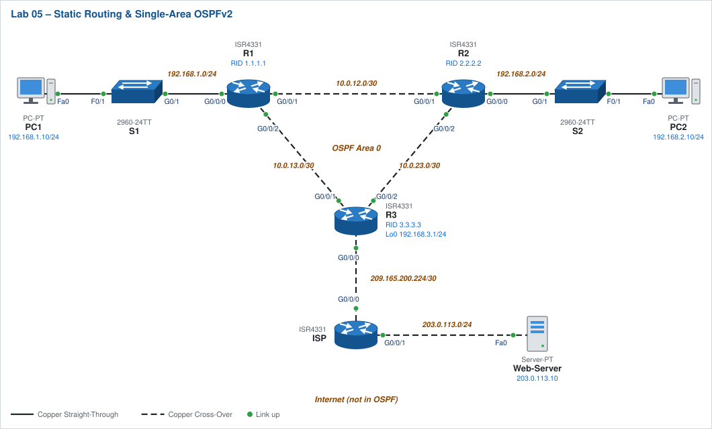

# Lab 05 – Static Routing & Single-Area OSPFv2

**Session 5 · Periods 21–25 · 225 minutes**

## Objectives

- Read and interpret the IPv4 routing table (codes, AD, metric, longest match).
- Configure next-hop, fully specified, default and floating static routes.
- Configure single-area OSPFv2 using network statements and interface commands.
- Set router IDs and passive interfaces; advertise a default route into OSPF.
- Tune OSPF: reference bandwidth, interface cost, timers, DR/BDR priority, point-to-point network type.
- Troubleshoot OSPF adjacency and route problems.

## Required Resources

| Qty | Device | Model |
|-----|--------|-------|
| 4 | Router | ISR4331 (R1, R2, R3, ISP) |
| 2 | Switch | 2960-24TT |
| 2 | PC | PC-PT |
| 1 | Server | Server-PT |

## Topology



<details>
<summary>Text version of the topology</summary>

```
     PC1 --- S1 ---G0/0/0                                G0/0/0--- S2 --- PC2
   192.168.1.0/24  +------+  G0/0/1   10.0.12.0/30  G0/0/1 +------+  192.168.2.0/24
                   |  R1  |--------------------------------|  R2  |
                   +------+                                +------+
                 G0/0/2 \                                  / G0/0/2
          10.0.13.0/30   \                                /   10.0.23.0/30
                  G0/0/1  \          +------+            /  G0/0/2
                           ----------|  R3  |------------
                                     +------+   Lo0 192.168.3.1/24
                                      G0/0/0
                                        |   209.165.200.224/30
                                      G0/0/0
                                     +------+
                                     | ISP  |
                                     +------+
                                      G0/0/1
                                        |   203.0.113.0/24
                                   Web-Server 203.0.113.10
```

</details>

## Addressing Table

| Device | Interface | IPv4 Address | Subnet Mask | Default Gateway |
|--------|-----------|--------------|-------------|-----------------|
| R1 | G0/0/0 | 192.168.1.1 | 255.255.255.0 | N/A |
| R1 | G0/0/1 | 10.0.12.1 | 255.255.255.252 | N/A |
| R1 | G0/0/2 | 10.0.13.1 | 255.255.255.252 | N/A |
| R2 | G0/0/0 | 192.168.2.1 | 255.255.255.0 | N/A |
| R2 | G0/0/1 | 10.0.12.2 | 255.255.255.252 | N/A |
| R2 | G0/0/2 | 10.0.23.1 | 255.255.255.252 | N/A |
| R3 | G0/0/0 | 209.165.200.226 | 255.255.255.252 | N/A |
| R3 | G0/0/1 | 10.0.13.2 | 255.255.255.252 | N/A |
| R3 | G0/0/2 | 10.0.23.2 | 255.255.255.252 | N/A |
| R3 | Lo0 | 192.168.3.1 | 255.255.255.0 | N/A |
| ISP | G0/0/0 | 209.165.200.225 | 255.255.255.252 | N/A |
| ISP | G0/0/1 | 203.0.113.1 | 255.255.255.0 | N/A |
| PC1 | NIC | 192.168.1.10 | 255.255.255.0 | 192.168.1.1 |
| PC2 | NIC | 192.168.2.10 | 255.255.255.0 | 192.168.2.1 |
| Web-Server | NIC | 203.0.113.10 | 255.255.255.0 | 203.0.113.1 |

> 💡 R3's LAN is simulated with a **loopback interface** – a virtual interface that is always up. This is a common lab technique when a router has no free physical ports.

---

## Period 21 – Part 1: Build the Network and Read the Routing Table

### Step 1: Build and cable

| From | Port | To | Port | Cable |
|------|------|----|------|-------|
| PC1 | Fa0 | S1 | F0/1 | Straight |
| S1 | G0/1 | R1 | G0/0/0 | Straight |
| PC2 | Fa0 | S2 | F0/1 | Straight |
| S2 | G0/1 | R2 | G0/0/0 | Straight |
| R1 | G0/0/1 | R2 | G0/0/1 | Cross-Over |
| R1 | G0/0/2 | R3 | G0/0/1 | Cross-Over |
| R2 | G0/0/2 | R3 | G0/0/2 | Cross-Over |
| R3 | G0/0/0 | ISP | G0/0/0 | Cross-Over |
| ISP | G0/0/1 | Web-Server | Fa0 | Cross-Over |

### Step 2: Base configuration on all routers

Example for R1 (repeat with R2, R3, ISP):

```
Router(config)# hostname R1
R1(config)# no ip domain-lookup
R1(config)# enable secret class
R1(config)# line console 0
R1(config-line)# password cisco
R1(config-line)# login
R1(config-line)# logging synchronous
R1(config-line)# exit
```

### Step 3: Configure interfaces

R1:

```
R1(config)# interface g0/0/0
R1(config-if)# ip address 192.168.1.1 255.255.255.0
R1(config-if)# no shutdown
R1(config-if)# interface g0/0/1
R1(config-if)# description to R2
R1(config-if)# ip address 10.0.12.1 255.255.255.252
R1(config-if)# no shutdown
R1(config-if)# interface g0/0/2
R1(config-if)# description to R3
R1(config-if)# ip address 10.0.13.1 255.255.255.252
R1(config-if)# no shutdown
```

R2:

```
R2(config)# interface g0/0/0
R2(config-if)# ip address 192.168.2.1 255.255.255.0
R2(config-if)# no shutdown
R2(config-if)# interface g0/0/1
R2(config-if)# description to R1
R2(config-if)# ip address 10.0.12.2 255.255.255.252
R2(config-if)# no shutdown
R2(config-if)# interface g0/0/2
R2(config-if)# description to R3
R2(config-if)# ip address 10.0.23.1 255.255.255.252
R2(config-if)# no shutdown
```

R3:

```
R3(config)# interface g0/0/0
R3(config-if)# description to ISP
R3(config-if)# ip address 209.165.200.226 255.255.255.252
R3(config-if)# no shutdown
R3(config-if)# interface g0/0/1
R3(config-if)# description to R1
R3(config-if)# ip address 10.0.13.2 255.255.255.252
R3(config-if)# no shutdown
R3(config-if)# interface g0/0/2
R3(config-if)# description to R2
R3(config-if)# ip address 10.0.23.2 255.255.255.252
R3(config-if)# no shutdown
R3(config-if)# interface loopback 0
R3(config-if)# description Simulated LAN
R3(config-if)# ip address 192.168.3.1 255.255.255.0
```

ISP:

```
ISP(config)# interface g0/0/0
ISP(config-if)# ip address 209.165.200.225 255.255.255.252
ISP(config-if)# no shutdown
ISP(config-if)# interface g0/0/1
ISP(config-if)# ip address 203.0.113.1 255.255.255.0
ISP(config-if)# no shutdown
```

Configure PC1, PC2 and Web-Server from the addressing table. On Web-Server, check that **Services → HTTP** is **On**.

### Step 4: Verify directly connected neighbors

```
R1# ping 10.0.12.2
R1# ping 10.0.13.2
R2# ping 10.0.23.2
R3# ping 209.165.200.225
```

### Step 5: Read the routing table

```
R1# show ip route
Codes: L - local, C - connected, S - static, R - RIP, M - mobile, B - BGP
       D - EIGRP, EX - EIGRP external, O - OSPF, IA - OSPF inter area
       ...
Gateway of last resort is not set

     10.0.0.0/8 is variably subnetted, 4 subnets, 2 masks
C       10.0.12.0/30 is directly connected, GigabitEthernet0/0/1
L       10.0.12.1/32 is directly connected, GigabitEthernet0/0/1
C       10.0.13.0/30 is directly connected, GigabitEthernet0/0/2
L       10.0.13.1/32 is directly connected, GigabitEthernet0/0/2
     192.168.1.0/24 is variably subnetted, 2 subnets, 2 masks
C       192.168.1.0/24 is directly connected, GigabitEthernet0/0/0
L       192.168.1.1/32 is directly connected, GigabitEthernet0/0/0
```

> 💡 **Anatomy of a route entry** (you will see this in Part 2):
> ```
> S    192.168.2.0/24 [1/0] via 10.0.12.2
> │    │              │ │      └── next hop
> │    │              │ └── metric
> │    │              └── administrative distance (AD)
> │    └── destination network / prefix
> └── route source code
> ```
>
> | Source | AD |
> |--------|----|
> | Connected | 0 |
> | Static | 1 |
> | EIGRP | 90 |
> | OSPF | 110 |
> | RIP | 120 |
> | External EIGRP | 170 |
>
> **Longest prefix match:** when several routes match a destination, the route with the longest prefix (most specific) is used, regardless of AD.

✅ **Checkpoint 1:** All directly connected pings succeed; you can explain every code in R1's routing table.

---

## Period 22 – Part 2: Static, Default and Floating Static Routes

### Step 1: Next-hop static routes on R1

```
R1(config)# ip route 192.168.2.0 255.255.255.0 10.0.12.2
R1(config)# ip route 10.0.23.0 255.255.255.252 10.0.12.2
```

### Step 2: Fully specified static route on R1

```
R1(config)# ip route 192.168.3.0 255.255.255.0 g0/0/2 10.0.13.2
```

> 💡 Three ways to write a static route:
> - **Next-hop:** `ip route <net> <mask> <next-hop-ip>` – requires a recursive lookup.
> - **Directly attached:** `ip route <net> <mask> <exit-int>` – fine on point-to-point serial, but on Ethernet it relies on proxy ARP. ⚠️ Avoid on Ethernet.
> - **Fully specified:** `ip route <net> <mask> <exit-int> <next-hop-ip>` – recommended on multi-access links.

### Step 3: Default routes

R3 is the edge router – everything unknown goes to the ISP:

```
R3(config)# ip route 0.0.0.0 0.0.0.0 209.165.200.225
```

R1 and R2 send unknown traffic toward R3:

```
R1(config)# ip route 0.0.0.0 0.0.0.0 10.0.13.2
R2(config)# ip route 0.0.0.0 0.0.0.0 10.0.23.2
```

### Step 4: Remaining static routes

R2:

```
R2(config)# ip route 192.168.1.0 255.255.255.0 10.0.12.1
R2(config)# ip route 192.168.3.0 255.255.255.0 10.0.23.2
R2(config)# ip route 10.0.13.0 255.255.255.252 10.0.23.2
```

R3:

```
R3(config)# ip route 192.168.1.0 255.255.255.0 10.0.13.1
R3(config)# ip route 192.168.2.0 255.255.255.0 10.0.23.1
R3(config)# ip route 10.0.12.0 255.255.255.252 10.0.13.1
```

ISP (in Lab 6 we'll replace this with NAT – an ISP never routes private addresses in reality):

```
ISP(config)# ip route 192.168.0.0 255.255.0.0 209.165.200.226
ISP(config)# ip route 10.0.0.0 255.0.0.0 209.165.200.226
```

> 💡 `192.168.0.0/16` is a **summary route** covering 192.168.1.0, .2.0 and .3.0.

### Step 5: Verify

```
R1# show ip route static
S*   0.0.0.0/0 [1/0] via 10.0.13.2
     10.0.0.0/8 is variably subnetted, 5 subnets, 2 masks
S       10.0.23.0/30 [1/0] via 10.0.12.2
S    192.168.2.0/24 [1/0] via 10.0.12.2
S    192.168.3.0/24 [1/0] via 10.0.13.2, GigabitEthernet0/0/2
```

| Test | Expected |
|------|----------|
| PC1 → PC2 `192.168.2.10` | ✅ |
| PC1 → `192.168.3.1` | ✅ |
| PC1 → Web-Server `203.0.113.10` | ✅ |
| PC1 web browser → `http://203.0.113.10` | Web page loads |
| PC1 `tracert 192.168.2.10` | 192.168.1.1 → 10.0.12.2 → 192.168.2.10 |

### Step 6: Floating static routes (backup path)

If the R1–R2 link fails, traffic between LAN1 and LAN2 should go through R3.

```
R1(config)# ip route 192.168.2.0 255.255.255.0 10.0.13.2 5
R2(config)# ip route 192.168.1.0 255.255.255.0 10.0.23.2 5
```

> 💡 AD **5** is worse than the primary static route (AD 1), so the floating route stays **out** of the routing table until the primary route disappears.

Test:

1. `R1# show ip route 192.168.2.0` → via 10.0.12.2.
2. Start `ping -t 192.168.2.10` on PC1.
3. `R1(config)# interface g0/0/1` → `shutdown`.
4. `R1# show ip route 192.168.2.0` → now `[5/0] via 10.0.13.2`. PC1 `tracert 192.168.2.10` → path via R3.
5. `no shutdown` the interface again – the primary route returns.

✅ **Checkpoint 2:** Full connectivity with static routes; the floating route takes over when R1 G0/0/1 is shut down.

---

## Period 23 – Part 3: Configure Single-Area OSPFv2

### Step 1: Remove the static routes (keep R3's default route and ISP routes)

R1:

```
R1(config)# no ip route 192.168.2.0 255.255.255.0 10.0.12.2
R1(config)# no ip route 192.168.2.0 255.255.255.0 10.0.13.2 5
R1(config)# no ip route 10.0.23.0 255.255.255.252 10.0.12.2
R1(config)# no ip route 192.168.3.0 255.255.255.0 g0/0/2 10.0.13.2
R1(config)# no ip route 0.0.0.0 0.0.0.0 10.0.13.2
```

R2:

```
R2(config)# no ip route 192.168.1.0 255.255.255.0 10.0.12.1
R2(config)# no ip route 192.168.1.0 255.255.255.0 10.0.23.2 5
R2(config)# no ip route 192.168.3.0 255.255.255.0 10.0.23.2
R2(config)# no ip route 10.0.13.0 255.255.255.252 10.0.23.2
R2(config)# no ip route 0.0.0.0 0.0.0.0 10.0.23.2
```

R3 (keep the default route!):

```
R3(config)# no ip route 192.168.1.0 255.255.255.0 10.0.13.1
R3(config)# no ip route 192.168.2.0 255.255.255.0 10.0.23.1
R3(config)# no ip route 10.0.12.0 255.255.255.252 10.0.13.1
```

Verify with `show ip route static` on each router.

### Step 2: OSPF on R1 – network statements

```
R1(config)# router ospf 10
R1(config-router)# router-id 1.1.1.1
R1(config-router)# network 192.168.1.0 0.0.0.255 area 0
R1(config-router)# network 10.0.12.0 0.0.0.3 area 0
R1(config-router)# network 10.0.13.0 0.0.0.3 area 0
R1(config-router)# passive-interface g0/0/0
R1(config-router)# end
```

> 💡 **Wildcard mask** = 255.255.255.255 − subnet mask. `/30` → `0.0.0.3`, `/24` → `0.0.0.255`. A `0` bit means "must match", a `1` bit means "ignore".
>
> 💡 The **process ID** (10) is locally significant – it does not need to match between routers. The **area** must match.
>
> 💡 **Router ID** selection: (1) `router-id` command, (2) highest loopback IP, (3) highest active physical IP.

### Step 3: OSPF on R2 – interface configuration method

```
R2(config)# router ospf 10
R2(config-router)# router-id 2.2.2.2
R2(config-router)# passive-interface g0/0/0
R2(config-router)# exit
R2(config)# interface g0/0/0
R2(config-if)# ip ospf 10 area 0
R2(config-if)# interface g0/0/1
R2(config-if)# ip ospf 10 area 0
R2(config-if)# interface g0/0/2
R2(config-if)# ip ospf 10 area 0
R2(config-if)# end
```

You should see:

```
%OSPF-5-ADJCHG: Process 10, Nbr 1.1.1.1 on GigabitEthernet0/0/1 from LOADING to FULL, Loading Done
```

### Step 4: OSPF on R3

```
R3(config)# router ospf 10
R3(config-router)# router-id 3.3.3.3
R3(config-router)# network 10.0.13.0 0.0.0.3 area 0
R3(config-router)# network 10.0.23.0 0.0.0.3 area 0
R3(config-router)# network 192.168.3.0 0.0.0.255 area 0
R3(config-router)# end
```

> ⚠️ Do **not** advertise the ISP link (`209.165.200.224/30`) into OSPF – we never form adjacencies with an ISP using our IGP.

### Step 5: Verify neighbors and routes

```
R1# show ip ospf neighbor
Neighbor ID     Pri   State           Dead Time   Address         Interface
2.2.2.2           1   FULL/DR         00:00:34    10.0.12.2       GigabitEthernet0/0/1
3.3.3.3           1   FULL/DR         00:00:31    10.0.13.2       GigabitEthernet0/0/2

R1# show ip route ospf
     10.0.0.0/8 is variably subnetted, 5 subnets, 2 masks
O       10.0.23.0/30 [110/2] via 10.0.12.2, GigabitEthernet0/0/1
                     [110/2] via 10.0.13.2, GigabitEthernet0/0/2
O    192.168.2.0/24 [110/2] via 10.0.12.2, GigabitEthernet0/0/1
     192.168.3.0/32 is subnetted, 1 subnets
O       192.168.3.1/32 [110/2] via 10.0.13.2, GigabitEthernet0/0/2

R1# show ip protocols
R1# show ip ospf interface brief
```

> 💡 Notice **equal-cost load balancing** to `10.0.23.0/30` (two paths, cost 2 each).
>
> 💡 Your `DR`/`BDR` labels may differ from the example – they depend on which router started OSPF first on each link. Part 4 explains the election.

### Step 6: Fix the loopback advertisement

R1 learns `192.168.3.1/32` instead of `/24`. OSPF advertises loopbacks as host routes by default. Fix on R3:

```
R3(config)# interface loopback 0
R3(config-if)# ip ospf network point-to-point
```

R1 now shows `O 192.168.3.0/24 [110/2] via 10.0.13.2`.

### Step 7: Test

PC1 → PC2 ✅, PC1 → 192.168.3.1 ✅. PC1 → Web-Server ❌ – R1 and R2 have **no default route** anymore. We fix this in Part 4.

✅ **Checkpoint 3:** Each router has two FULL neighbors; all internal networks are reachable through OSPF.

---

## Period 24 – Part 4: OSPF Tuning

### Step 1: Propagate the default route

```
R3(config)# router ospf 10
R3(config-router)# default-information originate
```

```
R1# show ip route | include 0.0.0.0
Gateway of last resort is 10.0.13.2 to network 0.0.0.0
O*E2 0.0.0.0/0 [110/1] via 10.0.13.2, GigabitEthernet0/0/2
```

PC1 → Web-Server `203.0.113.10` ✅. Open `http://203.0.113.10` in PC1's browser.

> 💡 `O*E2` = OSPF external type 2 candidate default. E2 routes keep the same metric (1) everywhere in the OSPF domain.

### Step 2: Adjust the reference bandwidth

Default cost = 100 Mbps / interface bandwidth. A GigabitEthernet and a FastEthernet both get cost **1** – OSPF can't tell them apart.

```
R1# show ip ospf interface g0/0/1 | include Cost
  Process ID 10, Router ID 1.1.1.1, Network Type BROADCAST, Cost: 1
```

On **all three** routers:

```
R1(config)# router ospf 10
R1(config-router)# auto-cost reference-bandwidth 10000
% OSPF: Reference bandwidth is changed.
        Please ensure reference bandwidth is consistent across all routers.
```

Now GigabitEthernet cost = 10000 / 1000 = **10**.

### Step 3: Manipulate the path with interface cost

Goal: traffic from R1 to LAN2 should prefer the path **through R3** (for example because the R1–R2 link is a cheaper, slower circuit).

```
R1(config)# interface g0/0/1
R1(config-if)# ip ospf cost 50
R2(config)# interface g0/0/1
R2(config-if)# ip ospf cost 50
```

```
R1# show ip route 192.168.2.0
  Known via "ospf 10", distance 110, metric 30
  * 10.0.13.2, from 2.2.2.2, via GigabitEthernet0/0/2
PC1> tracert 192.168.2.10     ! 192.168.1.1 → 10.0.13.2 → 10.0.23.1 → 192.168.2.10
```

Calculate: metric 30 = 10 (R1 G0/0/2) + 10 (R3 G0/0/2) + 10 (R2 G0/0/0). The direct path would be 50 + 10 = 60.

Remove the costs when finished (`no ip ospf cost` on both interfaces).

### Step 4: DR/BDR election on Ethernet links

```
R1# show ip ospf interface g0/0/1
  Designated Router (ID) 2.2.2.2, Interface address 10.0.12.2
  Backup Designated router (ID) 1.1.1.1, Interface address 10.0.12.1
  Timer intervals configured, Hello 10, Dead 40, Wait 40, Retransmit 5
```

> 💡 On multi-access (BROADCAST) networks OSPF elects a **DR** and **BDR**: highest interface priority (default 1) wins, then highest router ID. The election is **not preemptive**.

Make R1 the DR on the R1–R2 link:

```
R1(config)# interface g0/0/1
R1(config-if)# ip ospf priority 255
R1(config-if)# end
R1# clear ip ospf process
Reset ALL OSPF processes? [no]: yes
R1# show ip ospf neighbor
```

> ⚠️ If R1 is still not DR, also run `clear ip ospf process` on R2 (non-preemptive election).

### Step 5: Point-to-point network type

The router-to-router links have only two routers, so a DR/BDR election is unnecessary. Change **both** ends of all three transit links:

```
R1(config)# interface range g0/0/1 - 2
R1(config-if-range)# ip ospf network point-to-point
R2(config)# interface range g0/0/1 - 2
R2(config-if-range)# ip ospf network point-to-point
R3(config)# interface range g0/0/1 - 2
R3(config-if-range)# ip ospf network point-to-point
```

```
R1# show ip ospf neighbor
Neighbor ID     Pri   State           Dead Time   Address         Interface
2.2.2.2           0   FULL/  -        00:00:36    10.0.12.2       GigabitEthernet0/0/1
3.3.3.3           0   FULL/  -        00:00:33    10.0.13.2       GigabitEthernet0/0/2
```

### Step 6: Hello and dead timers

```
R1(config)# interface g0/0/1
R1(config-if)# ip ospf hello-interval 5
R1(config-if)# ip ospf dead-interval 20
```

Wait 40 seconds: the R1–R2 adjacency goes **down** (timers mismatch). Configure the same timers on R2 G0/0/1 – the adjacency returns. Then restore defaults on both (`no ip ospf hello-interval`, `no ip ospf dead-interval`).

✅ **Checkpoint 4:** Default route propagated; reference bandwidth 10000 on all routers; all transit links point-to-point; PC1 and PC2 reach the Web-Server.

---

## Period 25 – Part 5: OSPF Troubleshooting

### Step 1: Systematic OSPF troubleshooting

```
1. Is the interface up and addressed?        show ip interface brief
2. Is OSPF enabled on the interface?         show ip ospf interface brief
3. Are neighbors FULL?                       show ip ospf neighbor
4. Do the adjacency parameters match?        show ip ospf interface <int>
   (area, subnet/mask, hello/dead, network type, authentication, unique RID)
5. Is the interface passive?                 show ip protocols
6. Is the route in the table?                show ip route ospf
7. Is the database complete?                 show ip ospf database
```

### Step 2: Fault list

The instructor introduces **3** faults:

| # | Fault |
|---|-------|
| F1 | R2 G0/0/2 placed in `area 1` |
| F2 | `passive-interface g0/0/2` on R3 |
| F3 | R1 network statement `10.0.12.0 0.0.0.0 area 0` |
| F4 | R2 router-id changed to `1.1.1.1` (duplicate) |
| F5 | `default-information originate` removed on R3 |
| F6 | R3 G0/0/1 hello-interval 15 |
| F7 | R1 G0/0/2 mask changed to `255.255.255.248` |

> 💡 F7 is subtle: on point-to-point network types OSPF doesn't check the mask, but on broadcast links a mask mismatch prevents adjacency. Try it with both network types!

### Challenge (Extra credit)

1. Configure OSPF **MD5 authentication** on the R1–R2 link:
   ```
   interface g0/0/1
    ip ospf authentication message-digest
    ip ospf message-digest-key 1 md5 OSPFkey1
   ```
   Show what happens when only one side is configured.
2. Add **IPv6** to the topology (`2001:db8:acad:1::/64` on LAN1, `...:2::/64` on LAN2, `...:12::/64`, `...:13::/64`, `...:23::/64`) and configure **OSPFv3**: `ipv6 router ospf 10`, `router-id`, `ipv6 ospf 10 area 0` on interfaces.

## Review Questions

1. What is administrative distance? Which route wins if a static route and an OSPF route to the same prefix exist?
2. Why is a fully specified static route recommended on Ethernet interfaces?
3. How does a floating static route work?
4. Explain how OSPF selects its router ID.
5. What is the purpose of `passive-interface`? Name two benefits.
6. Why should the reference bandwidth be changed, and why consistently on every router?
7. Which parameters must match for two OSPF routers to become neighbors?
8. What does `O*E2` mean in the routing table?

Answers and final configurations: [solutions/](solutions/).
